The other pages of this section describe the design. This page says what of it you can use today,
what is being finished, and what comes next. The evidence behind each line is on the page it links to.

```mermaid
flowchart LR
  subgraph landed["Landed"]
    v1["Agent factory v1"]
    rooms["Attended rooms"]
    priv["Private repositories"]
    internal["Internal work on Claude"]
    gw["agentgateway, model tiers"]
    repo["Own repository and site"]
  end
  subgraph progress["In progress"]
    warm["Warm sandboxes"]
    caps["Per-person caps"]
    merge["Live auto-merge"]
    second["A second repository"]
  end
  subgraph next["Next"]
    cloud["v2.1: second cloud"]
    loop["Continuation loop, if needed"]
    serving["Serving paths"]
  end
  landed --> progress --> next
```

## Landed {#landed}

| Feature | What it does for you |
|---|---|
| Agent factory v1, shipped 2026-10-08 | A labelled issue becomes a reviewed pull request that a human merges, built by agents in a gVisor sandbox under their own identity ([agents]()) |
| Attended rooms with approval deadlines | Follow, steer and approve a run live; an approval answered after its deadline is refused ([rooms]()) |
| Private repositories | Room access follows each person's GitHub permission, proven on a private repository ([runbook 11](https://github.com/Smana/ai-native-ref/blob/main/docs/runbooks/agent-factory/11-v1-validation.md)) |
| Agents work on internal data through Claude, with prompt caching | Investigations and cluster or log reads run on Claude through the Anthropic API, clone read-only, and are priced at the gateway's price ([evidence](https://github.com/Smana/ai-native-ref/blob/main/docs/superpowers/plans/2026-10-15-agent-router-agentgateway-plan.md#live-evidence-internal-run-2026-10-16)) |
| agentgateway as the agents' gateway, with model tiers | Every agent call is checked, metered and routed to the model its tier names ([ADR-0053]()) |
| The reviewer keeps the implementer's model | Public work never goes to Anthropic for review ([ADR-0058]()) |
| A measured comparison on harder tasks | The factory against a hosted agent on 15 harder issues: the gap follows the model, not the factory ([results](https://github.com/Smana/ai-native-ref/blob/main/docs/superpowers/specs/2026-10-12-v2-hard-task-cohort-design.md#results)) |
| The AI platform in its own repository and site | Versioned and signed on its own, documented here; a rebuild from release pins closes the move ([ADR-0057]()) |
| Self-hosted model serving | vLLM on L4 GPUs behind an OpenAI-compatible gateway, off by default on both clouds ([known gaps]()) |

v1 is a pilot, not yet dependable: its hardening is tracked on the **v1 hardening** milestones of
[agent-platform](https://github.com/Smana/agent-platform/milestone/1) and
[cloud-native-ref](https://github.com/Smana/cloud-native-ref/milestone/1).

## In progress {#in-progress}


**Paused since 2026-10-16.** `aws-0` is torn down, its databases seeded and OpenBao snapshotted by the
destroy pipeline. Everything below resumes on `gcp-0`, standing alone, in the [order below](#after-the-2026-10-16-pause).


| Feature | What is left |
|---|---|
| Warm sandboxes: runs start in seconds, not minutes | The start-time proof is partly done: its remaining runs, one forcing a preemption, and a day of idle cost are left. The warm pool and suspend are not built ([results](https://github.com/Smana/ai-native-ref/blob/main/docs/superpowers/specs/2026-10-16-v2-warm-sandboxes-design.md#results)) |
| Per-person spend caps | Built and off. A shadow week comes next, then the daily limit is chosen before they are enforced ([runbook 04, Part C](https://github.com/Smana/ai-native-ref/blob/main/docs/runbooks/agent-factory/04-gateway-secrets-budgets.md#part-c--per-person-caps-the-shadow-week)) |
| Live auto-merge of link fixes and their reverts | GitHub setup (the merger App's permissions and two rulesets), then a live drill ([runbook 12](https://github.com/Smana/ai-native-ref/blob/main/docs/runbooks/agent-factory/12-live-auto-merge-drill.md)) |
| A second repository, `ai-native-ref` | The repository is prepared; GitHub setup, then the live checks ([design](https://github.com/Smana/ai-native-ref/blob/main/docs/superpowers/specs/2026-10-16-v2-second-repository-design.md)) |

### After the 2026-10-16 pause

1. Bring `gcp-0` up alone from release pins: it passes runbook 11, step 7, and closes the move to this repository ([runbook 14](https://github.com/Smana/ai-native-ref/blob/main/docs/runbooks/agent-factory/14-gcp-0-session.md)).
2. v2.1 on `gcp-0`: the factory reaches the identity provider over GKE's network, and the CPU quota allows its nodes.
3. The warm sandboxes' remaining start-time runs, then the day of idle cost.
4. Release the per-person caps' shadow mode and start the shadow week.
5. The GitHub setup, then the live auto-merge drill and the second repository.

## Roadmap {#v2-roadmap}

Each gate is a go/no-go on evidence; how each v2 decision is weighed is in the [v1 review](https://github.com/Smana/ai-native-ref/blob/main/docs/superpowers/specs/2026-10-12-agent-factory-v1-review.md#how-v2-is-judged).

| Next | When |
|---|---|
| v2.1: a second active cloud, `gcp-0` | When `gcp-0` runs live again: the factory reaches the identity provider over GKE's network and the CPU quota allows its nodes |
| A sandbox runtime spike, Substrate against agent-sandbox | Two days at the next `gcp-0` rebuild ([alternatives]()) |
| A continuation loop that picks a PR's next step from its state | Only if a cohort shows tasks abandoned on PRs that could still have been fixed |
| Budgets enforced at the gateway | Built behind one flag, still in shadow: a week of shadow record on real runs, then the owner flips it ([runbook 04, Part D](https://github.com/Smana/ai-native-ref/blob/main/docs/runbooks/agent-factory/04-gateway-secrets-budgets.md#part-d--enforcing-the-agents-budgets)) |

### Serving {#serving-roadmap}

| Path | Trigger |
|---|---|
| The endpoint picker on a high-traffic model | A model at two replicas or more without a LoRA canary (it is built, enabled on no claim) |
| Saturation of the InferencePool as an autoscaling trigger | Specified, not built: when the endpoint picker is on |
| A bigger coder model on the same L4 GPUs | The 7B coder hits its tool-call or correctness limits |
| A frontier coder on L40S in a second region | The quantized model's quality loss becomes measurable, or full-context work outgrows one L4 |
| Tensor-parallel on four L4 GPUs | The quantized model is not enough, and a second region costs more to run |
| Claude Code on the self-hosted models, through a protocol relay | The open-weights models get close enough to be a daily backend, or a no-telemetry workflow needs it |
| Heavier dense models (GLM-4.6, DeepSeek-Coder-V3) | A budget for H100-class GPUs, and stable tool-call parsing in vLLM |
| Cost per tenant | Several consumers share the platform, even simulated by LoRA adapter names |
