The other pages of this section describe the design. This page says what of it you can use today,
what is being finished, and what comes next. The evidence behind each line is on the page it links to.

```mermaid
flowchart LR
  subgraph landed["Landed"]
    v1["Agent factory v1"]
    rooms["Attended rooms"]
    priv["Private repositories"]
    internal["Internal work on Claude"]
    gw["agentgateway, model tiers"]
    repo["Own repository and site"]
    cloud["The factory on gcp-0"]
    warm["Warm sandboxes, off by default"]
    second["A second repository"]
    suspend["Suspend"]
    merge["Live auto-merge"]
    budgets["Gateway budgets enforced"]
  end
  subgraph progress["In progress"]
    caps["Per-person caps"]
  end
  subgraph next["Next: v3"]
    bench["Eval bench"]
    scoper["Scoper and stall limit"]
    checks["Repository checks in the sandbox"]
    tester["Test-first tester"]
    split["Splitter"]
    bake["Open-weight bake-off"]
    classes["More auto-merge classes"]
  end
  landed --> progress --> next
```

## Landed {#landed}

| Feature | What it does for you |
|---|---|
| Agent factory v1, shipped 2026-10-08 | A labelled issue becomes a reviewed pull request that a human merges, built by agents in a gVisor sandbox under their own identity ([agents]()) |
| Attended rooms with approval deadlines | Follow, steer and approve a run live; an approval answered after its deadline is refused ([rooms]()) |
| Private repositories | Room access follows each person's GitHub permission, proven on a private repository ([runbook 11](https://github.com/Smana/ai-native-ref/blob/main/docs/runbooks/agent-factory/11-v1-validation.md)) |
| Agents work on internal data through Claude, with prompt caching | Investigations and cluster or log reads run on Claude through the Anthropic API, clone read-only, and are priced at the gateway's price ([evidence](https://github.com/Smana/ai-native-ref/blob/main/docs/superpowers/plans/2026-10-15-agent-router-agentgateway-plan.md#live-evidence-internal-run-2026-10-16)) |
| agentgateway as the agents' gateway, with model tiers | Every agent call is checked, metered and routed to the model its tier names ([ADR-0053]()) |
| The reviewer keeps the implementer's model | Public work never goes to Anthropic for review ([ADR-0058]()) |
| A measured comparison on harder tasks | The factory against a hosted agent on 15 harder issues: the gap follows the model, not the factory ([results](https://github.com/Smana/ai-native-ref/blob/main/docs/superpowers/specs/2026-10-12-v2-hard-task-cohort-design.md#results)) |
| The AI platform in its own repository and site | Versioned and signed on its own, documented here; a rebuild from release pins closes the move ([ADR-0057]()) |
| The factory on `gcp-0` | Part of v2.0, first planned as a separate v2.1. The whole factory runs on GKE alone: a labelled issue became a merged pull request on release pins, its room followed live, and the gVisor pool scaled to its second node ([runbook 14](https://github.com/Smana/ai-native-ref/blob/main/docs/runbooks/agent-factory/14-gcp-0-session.md)) |
| Warm sandboxes, off by default on this platform | Turned on, a run starts in 16–17 s instead of 1.5–3.5 min (target 30 s), and a run preempts the warm capacity, never the reverse. Off here, since the warm node costs about $126 a month; a production platform turns it on with one value ([headroom](https://github.com/Smana/ai-native-ref/blob/main/docs/superpowers/specs/2026-10-16-v2-warm-sandboxes-design.md#headroom-off-by-default-on-for-production)) |
| A second repository, `ai-native-ref` | The factory takes issues from both repositories side by side. A room, a resumed branch or a run's token never crosses to the other repository, and a fence file names the one factory that acts on each. Proven on gcp-0 on 2026-10-18, except the read-only caller check (P5), not proven live ([results](https://github.com/Smana/ai-native-ref/blob/main/docs/superpowers/specs/2026-10-16-v2-second-repository-design.md#results)) |
| Suspend | A run waiting on a human gives up its pod and resumes with the same workspace and conversation, proven on gcp-0 on 2026-10-18 ([runbook 01](https://github.com/Smana/ai-native-ref/blob/main/docs/runbooks/agent-factory/01-runtime-sandbox.md#step-8--gcp-0-2026-10-18-ai-native-ref-v0114)) |
| Live auto-merge of link fixes and their reverts | A pull request that only fixes Markdown link targets merges without a human, at most once a day, at the head the gate decided. A revert asked with `factory/revert` is opened by the merger and demotes the class to human review. Proven on gcp-0 on 2026-10-18; the revert's own unattended merge is fixed in agent-platform #158 and proven offline ([runbook 12](https://github.com/Smana/ai-native-ref/blob/main/docs/runbooks/agent-factory/12-live-auto-merge-drill.md#2026-10-18-afternoon-gcp-0-g2-and-g3)) |
| Budgets enforced at the gateway | Since 2026-10-18 the gateway refuses an agent's call over its run, fleet or Anthropic budget with `429 agent_budget_exhausted`, instead of only counting it; a refusal was proven live the same day. Before the flip, a shadow record showed no real run over, and the overrun alert fires. The refusal alert reads the ratelimit service since [#81](https://github.com/Smana/ai-native-ref/issues/81), and fired live on 2026-10-18 ([runbook 04, Part D](https://github.com/Smana/ai-native-ref/blob/main/docs/runbooks/agent-factory/04-gateway-secrets-budgets.md#part-d--enforcing-the-agents-budgets)) |
| Self-hosted model serving | vLLM on L4 GPUs behind an OpenAI-compatible gateway, off by default on both clouds ([known gaps]()) |

v1 is a pilot, not yet dependable: its hardening is tracked on the **v1 hardening** milestones of
[agent-platform](https://github.com/Smana/agent-platform/milestone/1) and
[cloud-native-ref](https://github.com/Smana/cloud-native-ref/milestone/1).

## In progress {#in-progress}


**Paused between releases.** v2.0 shipped on `gcp-0` on 2026-10-18, then `gcp-0` was torn down, its
OpenBao snapshot and databases saved. A rebuild from the release pins restores it; the work below and
v3 resume there, in the [order below](#before-v3).


| Feature | What is left |
|---|---|
| Per-person spend caps | Counting, not refusing. Compressed same-day test 2026-10-17: every run was charged to its person, and none would have been refused. The recommended daily limit is the 5M-token default. Enforcing waits on daily caps that count dollars rather than raw tokens, and a longer record ([runbook 04](https://github.com/Smana/ai-native-ref/blob/main/docs/runbooks/agent-factory/04-gateway-secrets-budgets.md#parts-c-and-d--gcp-0-2026-10-17-compressed-same-day-test)) |

### Before v3 {#before-v3}

1. Rebuild `gcp-0` from the release pins, after three teardown fixes the last teardown showed: the
   load-balancer sweep also after an interactive confirmation, DNS records removed before their
   addresses are released, and a check that the deploy runs the repository's pinned tool versions.
2. Truthful costs: one price table with every copy generated from it, the metrics price rule first;
   daily caps in dollars; a nightly check against public price catalogs; the gateway's per-request
   cost as a cross-check; reconciliation with the provider's usage data
   ([pricing research](https://github.com/Smana/ai-native-ref/blob/main/docs/superpowers/specs/2026-10-20-model-pricing-research.md)).
3. Per-person caps: a longer shadow record before enforcing.
4. The breaker's live proof and the revert's unattended merge, at the next link-fix pull request and revert.

## Roadmap: v3 {#roadmap}

v3 makes the factory **land more accepted pull requests per dollar on the models it may use**. Public
work stays on open-weight models and internal work on Claude, so the lever is the task, not the
model: shape it to fit, measure every change, let the best open model win on our own issues. We are
[on the road to a dark factory](#dark-factory), one proven lane at a time. Each
feature is a go/no-go on the eval bench ([design](https://github.com/Smana/ai-native-ref/blob/main/docs/superpowers/specs/2026-10-19-v3-roadmap-design.md), [how v3 is judged](https://github.com/Smana/ai-native-ref/blob/main/docs/superpowers/specs/2026-10-19-v3-roadmap-design.md#how-v3-is-judged)).

| Feature | What it does for you | Gate |
|---|---|---|
| Eval bench | A fixed set of hard and routine issues, three runs each, scored on acceptance and cost per accepted pull request: every change below is judged on it | A baseline, with its run-to-run spread |
| Scoper | Rewrites a vague issue into a bounded task with acceptance criteria and the check that proves it, taken from a short steering note per class, or asks its author the question it could not answer | Fewer wandering runs, acceptance not lower |
| Stall limit | A run with no commit by its step limit stops and posts what it found, instead of spending its budget searching | Less spend on wandering runs |
| Repository checks in the sandbox | The agent runs the same checks as the CI before it pushes, so it fixes a failure without a CI round-trip. A feedback loop, not a second gate: the CI stays the only judge | Fewer fix runs after a red CI, acceptance not lower |
| Test-first tester | The tester writes the failing test first; it becomes the implementer's contract | Acceptance rises on routine issues |
| Search as a tool | The implementer asks a read-only search helper with a fresh context, instead of reading the repository itself | Fewer steps at equal acceptance |
| Splitter | A hard issue becomes sub-issues, each with its own check, built through the usual templates | Hard issues land through their sub-issues |
| Open-weight bake-off | The open models available compete on our issues; the winner per class sets the tier's model. Internal work picks Sonnet or Opus per task | A model beats GLM-5.3 on cost per accepted pull request |
| More auto-merge classes | Beyond link fixes: lint fixes and dependency bumps with green CI, as declarative risk tiers, each proven by a live drill | Each class stays within the breaker's revert budget |

Not in v3: public work on Claude, a doc-writer or standalone architect agent, memory across tasks,
parallel writers on one branch, and switching models in the middle of a run ([why](https://github.com/Smana/ai-native-ref/blob/main/docs/superpowers/specs/2026-10-19-v3-roadmap-design.md#not-in-v3)).

### On the road to a dark factory {#dark-factory}

A *dark factory* is the top of Dan Shapiro's levels of AI-assisted programming, named after robot
factories that run with the lights off: specs go in, software comes out, and no human writes or
reviews the changes ([the levels](https://simonwillison.net/2026/Jan/28/the-five-levels/)).
StrongDM's AI team runs one under two rules: code must not be written by humans, and must not be
reviewed by humans ([StrongDM](https://factory.strongdm.ai/)).

| Level | Who does what | Here |
|---|---|---|
| 3 · Developer | Agents write most of the code; a human reviews it | |
| 4 · Engineering team | Humans write the specs; agents build | **Most work**: a human writes the issue and approves the merge; agents implement and review each other |
| 5 · Dark factory | No human in the loop | **One lane**: link fixes merge with no human, at most once a day, and a revert sends the class back to human review |

We are not a dark factory yet, and we do not remove humans wholesale. Each class of change earns its
way to lights-out on evidence: a live drill, a revert breaker, a budget. v3's new auto-merge classes
are the next lanes, and the bench decides which. Dropping human review is a consequential choice,
not only a productivity one ([Stanford CodeX](https://law.stanford.edu/2026/02/08/built-by-agents-tested-by-agents-trusted-by-whom/)),
which is why each lane is reversible by one label.

### Later {#later}

| Feature | When |
|---|---|
| Install on any Kubernetes: a core profile on kind with any OIDC provider, a GitHub App and one model key; sandboxes through [agent-sandbox](https://github.com/kubernetes-sigs/agent-sandbox); cloud-native-ref as the reference profile | After v3: worth installing once the bench shows the outcomes ([shape](https://github.com/Smana/ai-native-ref/blob/main/docs/superpowers/specs/2026-10-19-v3-roadmap-design.md#later)) |
| Substrate as the sandbox runtime | Spike passed on `gcp-0` 2026-10-18: a run restores on another node with its conversation intact, and warm-starts in 2.9 s. Not adopted now (beta kubelet gates, a second control plane, no published images); next look 2026-12-15, or sooner if those costs shrink upstream ([spike](https://github.com/Smana/ai-native-ref/blob/main/docs/superpowers/specs/2026-10-17-substrate-spike.md#conclusion)) |
| The warm pool: pre-warmed sandboxes handed to a run (binder W1) | Needs the owner's acceptance of the binder's token-minting authority, unless agent-sandbox's warm pools replace it ([results](https://github.com/Smana/ai-native-ref/blob/main/docs/superpowers/specs/2026-10-16-v2-warm-sandboxes-design.md#results)) |
| A continuation loop that picks a PR's next step from its state | Only if the bench shows tasks abandoned on PRs that could still have been fixed |
| Untrusted-input hardening: an agent that writes only through validated outputs | When a repository takes issues from people outside its maintainers |

### Serving {#serving-roadmap}

| Path | Trigger |
|---|---|
| GPU sharing for the small always-warm models: native time-slicing, each model's memory fraction set, the GPU pool's limit counting shared replicas ([options]()) | Now: the FIM model and LlamaGuard each hold a whole L4 for a fraction of its memory; packing them frees a node, about $260–325 a month |
| The endpoint picker on a high-traffic model | A model at two replicas or more without a LoRA canary (it is built, enabled on no claim) |
| Saturation of the InferencePool as an autoscaling trigger | Specified, not built: when the endpoint picker is on |
| A bigger coder model on the same L4 GPUs | The 7B coder hits its tool-call or correctness limits |
| A frontier coder on L40S in a second region | The quantized model's quality loss becomes measurable, or full-context work outgrows one L4 |
| Tensor-parallel on four L4 GPUs | The quantized model is not enough, and a second region costs more to run |
| Claude Code on the self-hosted models, through a protocol relay | The open-weights models get close enough to be a daily backend, or a no-telemetry workflow needs it |
| Heavier dense models (GLM-4.6, DeepSeek-Coder-V3) | A budget for H100-class GPUs, and stable tool-call parsing in vLLM |
| Cost per tenant | Several consumers share the platform, even simulated by LoRA adapter names |
