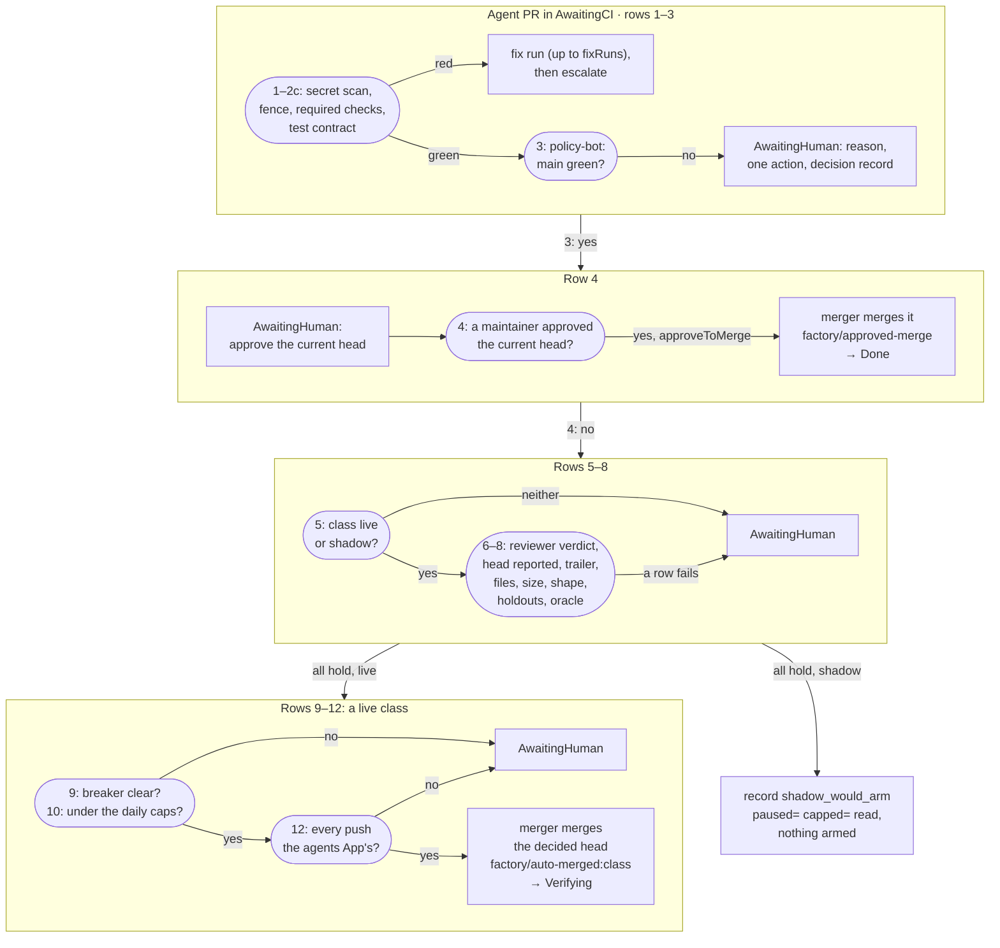

A lookup page for the codes you see in hand-off comments, in the room and in `maku status`. Why the gate
works this way: [the merge gate]().

## Terms {#terms}

| Term | Means |
|---|---|
| **live**, **shadow** | A live class merges by itself; a shadow class is decided and recorded, never merged |
| **holdout check** | A CI check the class requires, whose workflow the agent may not edit |
| **oracle** | The scan that found the problem a class fixes; it must then report the problem gone |
| **trailer** | The `Agent-Run:` line in a commit, naming the run that made it |
| **control issue** | The issue where the factory posts its notices and takes its kill switch |
| <span id="bypass"></span>**the bypass** | An admin merge (`gh pr merge --admin`) by a maintainer, after reading the change. Use it only for the reasons [no approval returns](#reasons) |

## The decision rows {#decision-rows}

The gate reads a pull request whose CI has run, row by row; the first "no" hands it to a human. With no
class `live` or `shadow` in the repository, it reads nothing and hands off as `merge_gate_off`.



| # | Check | If it fails |
|---|---|---|
| 1 | The secret scan (`merge.leakScanCheck`) is not red | Escalated, `secret_scan_red` |
| 2a | The repository names this factory as its owner | `not_owned` |
| 2 | Every `merge.requiredChecks` is green | Red: a fix run, up to `merge.fixRuns`, then `ci_red`. Cancelled: a re-run. Pending: wait |
| 2b, 2c | A task with a test contract: its check is green, and no contract file changed | As row 2; `contract_modified`, never a fix run |
| 3 | `policy-bot: main` is green, posted by policy-bot | `policy_absent`, `policy_pending`, `gate_path` |
| 4 | The author is the agents' App. With approve-to-merge, a maintainer's approval of the current commit merges here | `not_agent_authored`, `approval_stale`, `changes_requested` |
| 5 | The class is `live` or `shadow` | `class_unarmed` |
| 6 | The reviewer approved, the room reported the commit, every approval is of that commit | `no_approving_verdict`, `head_unreported`, `verdict_stale` |
| 7 | The commit's trailer names one of the task's runs | `foreign_trailer` |
| 8 | The class's limits: allowed and protected files, modify-only, files and lines, diff shape, holdout checks, oracle | `file_not_allowed`, `file_protected`, `file_added_or_deleted`, `patch_too_large`, `class_mismatch`, `holdout_red`, `oracle_finding_open`, `oracle_unrequested` |
| 9 | A live class: the breaker has not paused it | `class_paused` |
| 10 | A live class: under `merge.autoMergesPerDay` and the class's `maxPerDay` | `auto_merge_cap` |
| 11 | The class is `live` | `shadow_would_arm`: the decision is posted, nothing merges |
| 12 | Every push to the branch was the agents' App's | `human_commit_in_pr` |

A shadow class skips rows 9 and 10: it records `shadow_would_arm` whatever the breaker and the day's count
say, and its record notes what they read. Row 8 reads GitHub's own file list, and only once every other
row would merge. Maku's [merge gate](https://github.com/Smana/maku/blob/v0.32.3/docs/factory.md#the-merge-gate)
documents each reason's next step.

## Settings {#settings}

Example (the reference host), from `tooling/base/agent-factory/helm-values-configmap.yaml`:

| Setting | cloud-native-ref | ai-native-ref |
|---|---|---|
| `requiredChecks` | The 4 contexts of `main`'s protection | `validate`, `lint` |
| <span id="caps"></span>`autoMergesPerDay` | 1 | 2 |
| `fixRuns` | 2 | 1 |
| `verifyFor` · `revertWindow` | 30 min · 168 h | 30 min · 168 h |
| `approveToMerge` | `true` | `true` |
| `breaker` | `{window: 10, maxReverts: 1, maxFollowUps: 1, recoverAfter: 3}` | The same |

A class can set a lower `maxPerDay` of its own. Every other key: [harness reference]().

## Hand-off reasons {#reasons}

The common reasons and your move are on [the hand-off]().
A hand-off goes back to the gate by itself when its cause clears:

| Return | When |
|---|---|
| `reentered_approved` | A maintainer approved the commit it was handed off at |
| `reentered_day_turned` | An `auto_merge_cap` hand-off, on the next UTC day |
| `reentered_unpaused` | A `class_paused` hand-off, once the breaker lifts the pause |
| `reentered_policy` | policy-bot now passes the commit |

**No approval returns these nine.** Fix the pull request, or read it and use [the bypass](#bypass):
`not_agent_authored`, `gate_path`, `contract_modified`, `not_owned`, `steering_path`, `foreign_trailer`,
`not_mergeable`, `changes_requested`, `human_commit_in_pr`. One exception: a `changes_requested` hand-off
returns on an approval once no maintainer's newest review still requests changes.

## Run endings by role {#role-endings}

What each [role]() starts on and how its run can end. The
switches are per class, under `loops.<class>` and `repositories[].classes.<class>`.

| Role | Starts when | Ends with |
|---|---|---|
| Scoper | `loops.<class>.scope: scoper`; the task's first run | `ready` starts the implementer; `question` labels the issue `factory/needs-author`; `split_proposed`. Stopped at 40 tool calls (`budget_calls`) |
| Splitter | `loops.<class>.split`, after a maintainer's `/factory split` | 2 to `maxChildren` parts; the parent ends `children_merged`, `child_dropped` or `budget-family` |
| Tester | `classes.<class>.testFirst: true` (needs `checks: true`) | `contract_ready`, `not_testable`, `contract_not_red`, `contract_outside_tests`; escalates `contract_invalid`, `contract_disputed` |
| Implementer | Always; again on Request changes, red CI, `/factory retry` or a resume | Opens the pull request; `judge_impossible`, `stalled`, `not_met`, `deadline`, `budget-run`, `agent_error`, `stuck`, `contract_modified` |
| Completion judge | An implementer run that finishes, on a class with a loop row | `met`; `not_yet` continues the run, at most `continuations` (2) times; `impossible` escalates |
| Reviewer | The task's template (`pair`, `trio`) | Approve sends the task to CI; changes start a revision, at most `maxReviewRounds` (2); `review_rounds_exhausted`, `no_verdict` |
| Triager | A RunLore finding | `proposal_ready`, published by a maintainer's `factory/publish`; or `no_action` |

A failing named check is never `met`. A run with no scoper handoff runs the implementer unscoped.

## The decision record {#decision-record}

Every decision that is not a wait appends one hidden line to its comment, with what each row read.
Hand-offs post it on the issue; shadow decisions post it on the pull request. An example record:

```text
<!-- agent-factory-decision head=67dfa768 class=docs decision=human:class_unarmed files=-/0 lines=-/0 shape=- holdout=- oracle=- age=- evidence=- paused=- capped=- reviewer=glm-5.3 -->
```

| Field | Reads |
|---|---|
| `decision=` | `<verdict>:<reason>` |
| `files=`, `lines=` | GitHub's counts over the class's caps (0 is no cap) |
| `shape=`, `holdout=`, `oracle=`, `age=`, `evidence=` | `ok`, `n/a` when the class declares none, or the refusal's reason |
| `paused=`, `capped=` | What the breaker and the day's count said |
| `reviewer=` | The reviewer's served models; `none` without a reviewer |

`-` means unread, never `0`: a refusal leaves the rows after it unread. `merge_gate_off`,
`ledger_truncated` and the waits' own endings (`ci_cancelled`, `ci_wait_expired`) carry no record. To
count and replay records, see [run auto-merge safely]().
