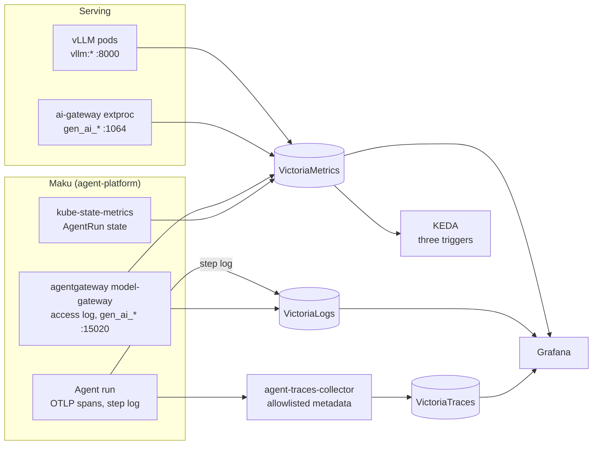

Both self-hosted model serving and Maku emit into Cloud Native Reference's shared Victoria stack and Grafana; nothing here runs a second telemetry pipeline. Serving is watched per model; Maku runs are watched per run.

## Serving telemetry {#serving}

| Signal | Source | Read it in |
|---|---|---|
| Engine metrics | Each vLLM pod's `/metrics` on port 8000 (`vllm:*` labelled by `model_name`), scraped by the `VMServiceScrape` each claim renders (`30s` interval) | *LLM Platform — Self-hosted vLLM Fleet*: replicas, queue depth, throughput, TTFT and decode latency, GPU KV-cache usage, prefix-cache hit rate |
| Gateway metrics | The AI Gateway extproc's `/metrics` on port 1064 (`gen_ai_*` OTel semantic conventions) | *LLM Gateway — Envoy AI Gateway GenAI Telemetry*: token spend per model, base-vs-canary attribution, TTFT and decode latency |
| Autoscaling | KEDA's three triggers query the same `vllm:*` series every 15 s | [Autoscaling & GPUs]() |

Both dashboards live in Grafana folder `llm` (`apps/base/ai/llm/grafana-folder.yaml`), created once `llm-platform` is resumed.

**Serving alerts** are lagging signals, deliberately not scale triggers:

| File | Alerts |
|---|---|
| `apps/base/ai/llm/vmrule-llm-slo.yaml` | Sustained queue depth, TTFT breached, replica scaled to zero, missing `gen_ai` telemetry, scrape down, high error rate, canary regressions |
| `apps/base/ai/llm/vmrule-ai-fleet.yaml` | Fleet abort rate, Semantic Router down, Promptfoo regression and staleness |

## Shared Victoria wiring for Maku {#agents}

On this host, `observability/base/agent-platform/` wires Maku's `maku_factory_*`, `maku_rooms_*`, and `agentgateway` signals into the same Victoria stack:

| Signal | Manifest path on this host |
|---|---|
| Grafana dashboards (`agent-run`, `agent-fleet`, `agents-overview`, `agent-room`, `agent-gateway`, `agent-identity`, `agent-factory`) | `observability/base/agent-platform/` |
| Factory and gateway alert rules (`VMRule`) | `observability/base/agent-platform/vmrule-agent-factory.yaml`, `observability/base/agent-platform/vmrule.yaml` |
| Metadata-only OTel trace gate (`agent-traces-collector`) | `observability/base/agent-platform/agent-traces-collector.yaml` |
| `agentgateway` → `gen_ai_*` cache-token scrape relabelling | `infrastructure/base/agent-gateway/vmpodscrape.yaml` |

Full Maku metric definitions, alert runbooks, and standalone observability setup live on Maku's documentation site: [Install › Observability](), [Reference › Metrics](), and [Reference › Alerts]().
