The one place the platform's state lives. Every other page describes the design. Each line here
names the clouds a capability was proven on, and links to the evidence: a runbook, its results, or
a design record.

**Current release:** the Agent Factory [v3.0.0](https://github.com/Smana/ai-native-ref/releases/tag/v3.0.0),
released on 2026-10-31. **On `main`** (tag `v3.10.0`): Maku v0.43.0 for the broker, the factory and the
Slack app; the harness and bridge stay on v0.32.3, composed by crossplane-configuration v0.9.32. **Coming:** Maku v0.44.0, with the fixes the last live check found ([below](#v3x)). **Next:**
[v3.x releases](#v3x) of this platform, then [v4, anyone can run it](#v4).

The Agent Factory is a bundle of open-source tools (Maku, agentgateway, OpenHands, gVisor, octo-sts,
RunLore, Kueue and others). [Maku](https://github.com/Smana/maku) is one of them: the factory
controller, the rooms, the harness and bridge, the Slack app and the `maku` CLI.

```mermaid
flowchart LR
  subgraph landed["Available: v1 and v2"]
    v1["Agent Factory v1"]
    rooms["Attended rooms"]
    gw["agentgateway, model tiers"]
    cloud["Runs on AWS EKS and GCP GKE"]
    merge["Auto-merge of link fixes"]
    budgets["Gateway budgets enforced"]
  end
  subgraph v3live["Available: v3"]
    scoper["Scoper and completion judge"]
    checks["Repository checks in the sandbox"]
    tester["Test-first tester"]
    slack["Slack intake"]
    runlore["RunLore agent to agent"]
    profiles["Capability profiles, cache alerts, spend per identity"]
    local["The factory from your coding agent"]
    split["Splitter"]
    providers["Moonshot and Mistral, public data only"]
    human["Approve-to-merge, breaker recovery, drills"]
  end
  subgraph v3built["Experimental"]
    search["Search for agents"]
    classes["More auto-merge classes"]
  end
  subgraph v3x["Next: v3.x releases, each behind a switch"]
    building["Being built: classes in your repository,<br/>plan then confirm, what needs you,<br/>push approval from Slack, run view,<br/>RunLore knowledge base, multi-repository,<br/>untrusted-input hardening"]
    next["Next: analytics, Gemini,<br/>review, verification, quality,<br/>scale, provenance, memory"]
  end
  subgraph v4["Then v4: anyone can run it"]
    laptop["Built: the factory on a laptop"]
    prod["The production path"]
  end
  subgraph later["Planned"]
    bench["Eval bench and bake-off"]
  end
  landed --> v3live --> v3built --> v3x --> v4 --> later
```

## Available {#landed}

Built, proven end to end, and usable now. *Opt-in* means it is off by default, and an operator turns
it on with one value, per class or per platform.

| Capability | What it does for you | Proven on | Evidence |
|---|---|---|---|
| The Agent Factory | A labelled issue becomes a reviewed pull request, built by agents in a gVisor sandbox under their own identity | EKS, GKE | [runbook 07](https://github.com/Smana/ai-native-ref/blob/main/docs/runbooks/agent-factory/07-end-to-end.md), [runbook 14](https://github.com/Smana/ai-native-ref/blob/main/docs/runbooks/agent-factory/14-gcp-0-session.md) |
| Attended rooms | Follow, steer and approve a run live; an approval after its deadline is refused | EKS, GKE | [rooms]() |
| Private repositories | Room access follows each person's GitHub permission | GKE | [runbook 11](https://github.com/Smana/ai-native-ref/blob/main/docs/runbooks/agent-factory/11-v1-validation.md) |
| Several repositories | Repositories are served side by side; no room, branch or token crosses between them | GKE | [results](https://github.com/Smana/ai-native-ref/blob/main/docs/superpowers/specs/2026-10-16-v2-second-repository-design.md#results) |
| Internal work on Claude | Investigations run on Claude through the Anthropic API, read-only, with prompt caching | GKE | [ADR-0054]() |
| agentgateway and model tiers | Every agent call is checked, metered and routed to the model its tier names | EKS, GKE | [ADR-0053]() |
| Budgets enforced at the gateway | A call over its run, fleet or Anthropic budget is refused with `429 agent_budget_exhausted` | GKE | [runbook 04, Part D](https://github.com/Smana/ai-native-ref/blob/main/docs/runbooks/agent-factory/04-gateway-secrets-budgets.md#part-d--enforcing-the-agents-budgets) |
| Suspend | A run waiting on a human gives up its pod, then resumes with the same workspace and conversation | GKE | [runbook 01](https://github.com/Smana/ai-native-ref/blob/main/docs/runbooks/agent-factory/01-runtime-sandbox.md) |
| Resume after a lost node | A run lost to a spot reclaim resumes from its branch on its own | EKS, GKE | [runbook 10](https://github.com/Smana/ai-native-ref/blob/main/docs/runbooks/agent-factory/10-disruption.md) |
| Warm sandboxes (opt-in) | A run starts in about 17 s instead of minutes; a run preempts the warm capacity, never the reverse | EKS, GKE | [design](https://github.com/Smana/ai-native-ref/blob/main/docs/superpowers/specs/2026-10-16-v2-warm-sandboxes-design.md#results) |
| Auto-merge of link fixes and their reverts | A link-only fix merges with no human, at most once a day; a revert demotes the class to human review | EKS, GKE | [runbook 12](https://github.com/Smana/ai-native-ref/blob/main/docs/runbooks/agent-factory/12-live-auto-merge-drill.md) |
| Approve-to-merge | A maintainer's approval of the current head is the merge, outside the auto-merge caps. The merger App merges within a minute of the approval, and the merge gate posts its verdict on the pull request. An approved head no run reported waits as `head_unreported`, and the harness reports a head the agent pushed but left unreported | EKS, GKE | [results](https://github.com/Smana/ai-native-ref/blob/main/docs/runbooks/agent-factory/results-aws-0-2026-10-30.md) |
| Regression breaker, drills and recovery | A regression pauses its class; a drill revert is not counted; three clean merges lift a pause | EKS | [results](https://github.com/Smana/ai-native-ref/blob/main/docs/runbooks/agent-factory/results-aws-0-2026-10-30.md) |
| Scoper | A labelled issue becomes a bounded task with acceptance checks, or the factory asks its author one question | GKE | [Layer 1](https://github.com/Smana/ai-native-ref/blob/main/docs/runbooks/agent-factory/README.md#layer-1-the-scoper) |
| Completion judge | A fresh-context judge says `met`, `not_yet` or `impossible` against the task's checks | GKE | [Layer 2](https://github.com/Smana/ai-native-ref/blob/main/docs/runbooks/agent-factory/README.md#layer-2-the-loop-policy) |
| Repository checks in the sandbox | The implementer runs the repository's checks before it pushes; the CI stays the judge | GKE | [Layer 3](https://github.com/Smana/ai-native-ref/blob/main/docs/runbooks/agent-factory/README.md#layer-3-the-sandbox-checks) |
| Test-first tester (opt-in) | A tester commits a failing test contract; the implementer works to it | GKE | [runbook 21](https://github.com/Smana/ai-native-ref/blob/main/docs/runbooks/agent-factory/21-test-first-tester.md) |
| Splitter | A task too big for one pull request is proposed as parts with a merge order | GKE | [runbook 17](https://github.com/Smana/ai-native-ref/blob/main/docs/runbooks/agent-factory/17-splitter.md) |
| Slack intake | A mention drafts the issue; a maintainer's ✅ files it and starts the task. The proposal message that replaces the draft is a [v3.x track](#v3x) | GKE | [runbook 22](https://github.com/Smana/ai-native-ref/blob/main/docs/runbooks/agent-factory/22-slack.md) |
| The factory from your coding agent | Claude Code and OpenCode hand off, file, wait on (`room_wait`) and check out (`room_checkout`) a task through the `maku` CLI and its MCP server; starting a task from your session is opt-in | EKS, GKE | [runbook 19](https://github.com/Smana/ai-native-ref/blob/main/docs/runbooks/agent-factory/19-factory-from-your-agent.md) |
| RunLore agent to agent (opt-in) | An alert becomes an investigation, a fix pull request, and a verdict after the merge | GKE | [runbook 20](https://github.com/Smana/ai-native-ref/blob/main/docs/runbooks/agent-factory/20-runlore-agent-to-agent.md) |
| Capability profiles | Each role and data class has a model allow-list; every run is pinned to one model | GKE | [runbook 14](https://github.com/Smana/ai-native-ref/blob/main/docs/runbooks/agent-factory/14-gcp-0-session.md#feature-15-providers-a-smoke-through-the-gateway) |
| Moonshot and Mistral (opt-in) | Kimi and Mistral models for **public data only**, selectable per class, and a fallback when your default provider is unavailable: Kimi ran the scoper, implementer and reviewer through to merged pull requests, and Mistral ran the planner | GKE | [providers]() |
| Cache alerts | Alerts on the share of input read from cache | GKE | [runbook 04, Part E](https://github.com/Smana/ai-native-ref/blob/main/docs/runbooks/agent-factory/04-gateway-secrets-budgets.md#part-e--the-cache-read-share) |
| Spend per identity | One dashboard per person and per sponsored principal, and cost by role | GKE | [runbook 04, Part G](https://github.com/Smana/ai-native-ref/blob/main/docs/runbooks/agent-factory/04-gateway-secrets-budgets.md#part-g--the-cost-cross-check) |
| The factory's settings as objects | A change to the `Factory` object applies on the next decision with no restart; a bad edit is refused, and the last good version keeps serving. Suspending Flux and resuming it restores what Git says | GKE | [runbook 14](https://github.com/Smana/ai-native-ref/blob/main/docs/runbooks/agent-factory/14-gcp-0-session.md) |
| Spec intake guards and one status comment | A request that still has an open question is refused at every door, and a tampered plan is refused with a named reason. Each task has exactly one status comment, edited in place across its phases. It survives a factory restart, comes back once after you delete it, and a second generation of the task adopts it | GKE | [Maku design](https://github.com/Smana/maku/blob/main/docs/superpowers/specs/2026-11-09-spec-intake-design.md) |
| Room and intake UX | The approvals page, a status line per room, attended forks, a daily task cap; a room header grouped by topic, an action on every need, folded briefs, and settings in tabs | EKS, GKE | [the room page]() |

Hardening is tracked on the **v1 hardening** milestones of
[Maku](https://github.com/Smana/maku/milestone/1) and
[cloud-native-ref](https://github.com/Smana/cloud-native-ref/milestone/1).

**Auto-merge class modes**, from the `Repository` objects' bindings in `tooling/base/agent-factory/resources/`
([when a pull request merges]()):
cloud-native-ref has `docs-links` and `revert` live, and `alert-rules`, `dead-links`, `deps-patch` and
`deps-minor` in shadow; every ai-native-ref class, every runlore class and every runlore-kb class (`kb-entries`
among them) is in shadow; `approveToMerge` is on for all four.

## Experimental {#experimental}

Built, but off by default or on for a few classes only while its value is measured.

| Capability | State | Evidence |
|---|---|---|
| Search for agents | The implementer asks a read-only search helper instead of reading the repository; its benefit is unmeasured | [Layer 4](https://github.com/Smana/ai-native-ref/blob/main/docs/runbooks/agent-factory/README.md#layer-4-the-search-tool) |
| More auto-merge classes | `dead-links` and `deps-patch` decide in shadow, `deps-minor` observes. A class leaves shadow after a full day's proof | [runbook 15](https://github.com/Smana/ai-native-ref/blob/main/docs/runbooks/agent-factory/15-dead-links.md), [runbook 16](https://github.com/Smana/ai-native-ref/blob/main/docs/runbooks/agent-factory/16-deps-patch.md) |
| Outcome overlap at intake (shadow) | A request that restates an active task is classed as a duplicate of it and cites that task, then proceeds: in shadow nothing is refused. A request that restates a completed task cites its pull request the same way. Matching on loose wording alone can flag an unrelated task as a candidate before the scoper rules it out; refusing duplicates is off | [Maku design](https://github.com/Smana/maku/blob/main/docs/superpowers/specs/2026-11-11-intake-outcome-overlap-design.md) |
| Approval memory | The settings page, the grants API and the export answer, and no grant exists yet: a grant needs a maintainer's approval of a pull request in a live class | [Maku design](https://github.com/Smana/maku/blob/main/docs/merge-policies.md) |
| Self-hosted model serving | vLLM on L4 GPUs behind an OpenAI-compatible gateway; off by default on both clouds | [serving]() |
| Per-person and fleet daily caps | Counted in shadow, not refused, until a longer record says enforcing is safe | [runbook 04, Part C](https://github.com/Smana/ai-native-ref/blob/main/docs/runbooks/agent-factory/04-gateway-secrets-budgets.md#part-c--per-person-caps-the-shadow-week) |

## v3.x: what ships before v4 {#v3x}

Everything that ships before v4 is a v3.x release of the current platform. Each feature is a track,
off by default until an operator turns it on with one value. A track ships one increment at a time:
its offline proofs, a release, a live proof, then the switch-on. Each track gets its own design first
([roadmap](https://github.com/Smana/ai-native-ref/blob/main/docs/superpowers/specs/2026-10-31-v4-roadmap-design.md#v3x)).

**Being built:**

| Feature | What it will do for you | State |
|---|---|---|
| **Merge classes declared in your repository** | You declare which kinds of change may merge on their own, in your own repository, against a schema; the factory's gate and the policy-bot rule are generated from that one declaration. Presets for common classes, a ceiling the platform sets, and promotion from shadow once a replay of past decisions shows the class is safe | All six stages built. Stages 1 to 3 are on: the factory reads your repository's classes, replays them against its own, and decides every real merge both ways while the central policy still rules; stage 3 exits after a week of these decisions with no unexplained disagreement. Stage 6 is on: the settings editor, promotion evidence and promotion requests ([how to use them]()). Stages 4 and 5 (your repository's file decides, remembered approvals) are built and off by default; with stage 5 on, its page, API and export work live and no approval has been remembered yet. Known gaps: no central guardrails yet, and the policy-bot rule is still written by hand ([UX review](https://github.com/Smana/ai-native-ref/blob/main/docs/superpowers/specs/2026-11-08-merge-policy-ux-review.md), [guide](https://github.com/Smana/maku/blob/main/docs/merge-policies.md)). **Needed for v4** |
| **Say what you want, then read the plan** | In Slack or your coding agent, describe the work in your own words. One governed model call proposes the repository with the evidence for it, the issue as it will be filed, the roles that will run, the checks that will judge it and what it may cost, and asks at most one question. You confirm, and only then does an issue exist. Public repositories only | On for one public repository, from your coding agent and from Slack. In Slack it works live for a user who linked themselves with `@factory link`: a mention gives a proposal, and a reply re-plans it. Confirm was refused over a repository name's capitalisation (fixed for v0.44.0, retest pending). Known weakness: the planner's grounding, which accepted a false premise in a request and found no open question in a vague one; a fix is coming in v0.44.0 |
| **One list of what needs you, and a short brief on return** | The room page, the CLI, your coding agent and a Slack thread show the same list in the same order, each item with one action and one link. Coming back after a day away gives you a short, fixed brief: what was asked, which plan ran, what changed, what blocks it, and the one next step | The list, the brief, revisions first and settled dollars are built and on in the platform; waiting for their live proof |
| **Approve a push from Slack** | The most frequent approval in an attended room, "may this run push to its branch?", arrives as one card with Approve and Deny, bound to that run's branch, under the same four-eyes rule, room standing and repository permission the room page applies. Merging is unchanged: you review the current head on GitHub | On in the platform for the one served channel; waiting for its live proof |
| **Slack: one proposal message, then a thread that answers** | A mention produces one message, edited in place as you reply. Confirm it and the thread goes on telling you how the work goes; ask it how it is going, what needs you or where the pull request is, and it answers | On for the one served channel; the proposal message works live, the thread's answers wait for their live proof, and Confirm waits for its retest |
| **The animated run view** | The room page draws the task as a path: a node per run, named by its role and model, the planned steps lighting up as each run starts, and a replay when the task ends. Still to come: a timeline of every tool call, check, decision and cost, and two runs of the same task compared side by side | The path is built and in the platform, not yet proven end to end |
| **RunLore's knowledge base, filled by the factory** | What an investigation learns about the running platform becomes a reviewed entry in the knowledge base, and the entries that are safe to merge go through a curated queue rather than waiting on you one by one | The loop is proven live: an incident became a fix, then a verified entry, and a replay recorded merged fixes on their entries ([runbook 25](https://github.com/Smana/ai-native-ref/blob/main/docs/runbooks/agent-factory/25-runlore-kb-phase-1.md), [live 4](https://github.com/Smana/ai-native-ref/blob/main/docs/runbooks/agent-factory/results-runlore-kb-live-4-2026-11-08.md)). Live 1 (a restart keeps the soak) and live 3 (a second generation) are not run. Off by default; `kb-entries` decides in shadow |
| **Multi-repository coordination** | One change across two repositories, confirmed once: a parent issue that records the change and never writes code, one ordinary task per repository with its own maintainer, branch, gate and pull request, a landed file as the dependency, and a read-only check that the two work together | Plan mode is on, on aws-0: it composes a validated plan across `Smana/ai-native-ref` and `Smana/runlore-kb` and files nothing. Execute refuses every filing until merge classes in your repository and untrusted-input hardening ship. The integration runtime (exact-commit worktrees, one typed result) is built and inert. Four alerts cover integration failures, lost authority, stalls and a recovery standing past 15 minutes ([design](https://github.com/Smana/ai-native-ref/blob/main/docs/superpowers/specs/2026-11-05-v4-multi-repo-coordination-design.md), [factory](https://github.com/Smana/maku/blob/main/docs/factory.md#multi-repository-coordination)) |
| **Untrusted-input hardening** | For repositories where strangers file issues: the agent writes only through validated outputs, text from people outside the maintainers is filtered, outputs pass a threat check before they apply, and CI configuration, agent instructions and manifests stay out of the agent's reach. Scripted injection attacks against every role prove it, on a schedule like the merge-gate drills. **Needed for v4** | Stage H0 is built: the contracts, switched off, changing no behaviour. H1 to H5 (audit, non-code outputs enforced, push enforced, reads filtered, ready) are next ([design](https://github.com/Smana/ai-native-ref/blob/main/docs/superpowers/specs/2026-11-07-untrusted-input-hardening-design.md)) |
| **Team evaluation profiles** | Evaluation profiles per team, with outcome metrics, so each team's runs are judged against its own profile | Built in Maku v0.41.0 ([#427](https://github.com/Smana/maku/pull/427), [#431](https://github.com/Smana/maku/pull/431)). Live, every task records its profile, but no evaluation runs: a task given a class by label joins a cohort the evaluation excludes, and without a classifier no class carries a profile choice. It waits for the profile-choice design |
| **Clarify and track a spec** | The intake asks what is unclear about a factory spec and tracks it from request to pull request | Built in Maku v0.41.1 ([#419](https://github.com/Smana/maku/pull/419)); its guards and status comment are [available](#landed). The scoper's question reaches the author and the task waits, but answering it through `need_answer` was refused on an issue with no acceptance section; the fix is coming in v0.44.0 |

**Landed in Maku v0.42.0:**

- The coding agent's form times out cleanly: when a client never answers `issue_file`'s form, the factory falls back to the draft, and the handoff skill checks its prerequisites first ([#442](https://github.com/Smana/maku/pull/442)).
- Slack quick wins: a refused first mention says why, planner progress shows, the closed phrases are listed ([#444](https://github.com/Smana/maku/pull/444)).

**Landed in Maku v0.43.0:**

- Outcome overlap at intake, in shadow by default ([#453](https://github.com/Smana/maku/pull/453)), and a proof of spec intake on a local cluster ([#446](https://github.com/Smana/maku/pull/446)).
- Typed tool schemas, so a model that validates them strictly, such as Kimi, can run the factory's agents; a provider's refusal for billing holds the task instead of escalating it; an unreachable repository no longer stops the factory from serving the others ([#352](https://github.com/Smana/ai-native-ref/pull/352)).

**Coming in Maku v0.44.0:**

- `need_answer` accepts an answer for an issue with no acceptance section.
- The planner always asks at least one question when the request leaves a gap open, and its evidence is labelled as the model's claim.
- Slack's Confirm accepts a repository however its name is capitalised.

**Still to prove live:** Slack's Confirm after that fix, the OpenCode handoff, team evaluation, and answering a scoper's question through `need_answer`.

**Designs, open** in Maku:

- Natural-language intents in Slack rooms ([#441](https://github.com/Smana/maku/pull/441)) and a suggested workflow and profile choice at intake ([#443](https://github.com/Smana/maku/pull/443)). The profile choice is planner-first: the planner suggests the class and profile, and you override within what the class allows. Slack's natural-language intents get an ADR before any code; read intents are answered directly, and a write goes through a Confirm card.

**Next:**

| Feature | What it will do for you |
|---|---|
| **Outcome analytics** | Merge rate, revert rate, time to merge, rework and cost per merged pull request, per class, model, role and repository, on a dashboard and in a weekly report |
| **Gemini** | Gemini as a model you can select for public work, with its own capability profile and cost check, the way Kimi and Mistral were added |
| **Review inbox** | One queue of the agents' pull requests waiting on a human, across all your repositories, ranked by risk, class and age, routed to their owners; stale ones are closed |
| **Plan approval** | Per class, the scoper's plan waits for a maintainer's approval before any code is written, so a wrong plan costs one comment, not a run and a review |
| **Verification on real services** | Before the pull request opens, the change runs against real dependencies: ephemeral services, scoped test credentials, a preview, and screenshots for interface changes |
| **The continuation loop** | The factory drives its own pull request to the merge: it fixes red CI, answers review comments, rebases, and resolves merge conflicts |
| **Judge and reviewer calibration** | How often the completion judge said "done" and the reviewer said "approve" on work that was later reverted or reworked, per model and class, so you know when a cheaper judge is safe. After outcome analytics |
| **Reviewer severity and resolution** | The reviewer ranks its findings by severity; the factory tracks which ones were fixed and mutes rules that are rarely acted on. After outcome analytics |
| **Event triggers and schedules** | Tasks start from events, not only issues: main's CI turning red, a security alert, or a schedule for recurring maintenance. After merge classes in your repository and hardening |
| **Fleet campaigns** | One change applied across many repositories, with a view of its progress to 100% and the long tail handed to owners. After merge classes in your repository and hardening |
| **Signed provenance** | Every agent commit carries a signed attestation of the run, model, prompt, policy and checks that produced it, which anyone can verify later |
| **Repository memory, as reviewed code** | Agents propose what they learned (build quirks, conventions, gotchas) as small pull requests to the repository's agent instructions, reviewed like any change: no hidden memory. After hardening and calibration |

The natural-language planner reads public text only, and a private repository is refused before any
model call. A resume brief, the inbox and a proposal are derived, never stored, so turning a switch off
returns today's behaviour.

## v4: anyone can run it {#v4}

v3 made the factory land more accepted pull requests per dollar on the reference host. v4 makes it run
**for anyone, outside the reference host**. It is written for a platform engineer who knows
Kubernetes, Helm, GitOps and GitHub Apps and is new to agents. v4 ships when both stages below pass,
and when merge classes in your repository and untrusted-input hardening have shipped as v3.x
releases, because an outside repository's issues come from strangers. Whatever else has shipped by
then is part of v4 ([roadmap](https://github.com/Smana/ai-native-ref/blob/main/docs/superpowers/specs/2026-10-31-v4-roadmap-design.md#v4-0)).

| Feature | What it will do for you | State |
|---|---|---|
| **The factory on a laptop** | About 15 minutes from the docs alone, on kind or k3d: one command asks for your model endpoint and key, you click twice on GitHub to create the factory's App, and you get a repository made from a template. Label its first issue, watch the agents work in a room, get a reviewed pull request, and see the merge gate post its verdict; one value lets it merge. It is a demo of how production works, on public repositories only: a table on the quickstart page lists what production adds, such as isolation, per-role tokens and budgets. A nightly job proves the loop | **Built** in Maku (v0.35 to v0.37): `task demo`, the `charts/agent-factory` umbrella chart and the quickstart ([#347](https://github.com/Smana/maku/pull/347), [#350](https://github.com/Smana/maku/pull/350), [#352](https://github.com/Smana/maku/pull/352), [#356](https://github.com/Smana/maku/pull/356), [#362](https://github.com/Smana/maku/pull/362), [#363](https://github.com/Smana/maku/pull/363), [#366](https://github.com/Smana/maku/pull/366)). Its go test still needs the nightly kind job green with its secrets, and one outside person's friction log |
| **The production path** | Install on your own cluster from one Helm chart that Flux and Argo CD both consume. You bring your identity provider through OIDC, your secrets store and your GitOps tool; agentgateway and gVisor ship as required pieces. Each seam says what you lose if you leave it out. Proven on a plain k3s or kubeadm cluster with a smoke test, on public repositories; private repositories are documented | Not started |
| **Upgrades you can plan for** | From v4, chart values and the install contract follow semantic versioning: a breaking change waits for a major release or comes with a migration note, and a nightly job upgrades the previous release | Not started |

The laptop stage is built; the production path is the work left before v4.

## Planned {#later}

| Feature | When |
|---|---|
| Triage classifier: a task's tier from its difficulty ([routing]()) | Designed, not built; every task is `standard` until then |
| Eval bench: fixed issues, three runs each, scored on acceptance and cost per accepted pull request ([design](https://github.com/Smana/ai-native-ref/blob/main/docs/superpowers/specs/2026-10-22-eval-bench-design.md)) | If a sponsor funds the bench sessions |
| Open-weight bake-off: open models compete per class; the winner becomes its implementer's model | With the bench |
| Agent-to-agent protocols and trackers: an A2A card; Jira or Linear as delegates | When a consumer speaks A2A or a tracker is in use |
| Webhook subscribers registered through an API | When subscribers outgrow a reviewed list |
| Finer permissions: an external policy decision point; a token per backend | When a policy outgrows the compiled gateway rules |
| Substrate as the sandbox runtime. A spike passed; it is not adopted now ([why]()) | When a measured runtime problem meets the [ADR-0062]() triggers |
| The warm pool: pre-warmed sandboxes handed to a run | After a decision on the binder's token-minting authority, unless agent-sandbox's warm pools replace it |

Not planned: public work on Claude, a doc-writer or standalone architect agent, parallel writers on
one branch, switching models in the middle of a run
([why](https://github.com/Smana/ai-native-ref/blob/main/docs/superpowers/specs/2026-10-19-v3-roadmap-design.md#not-in-v3)), and
steering a run from Slack or MCP, which stays in the rooms web UI. Install on any Kubernetes is
[v4](#v4); the continuation loop, untrusted-input hardening and repository memory are
[v3.x tracks](#v3x). Approving
from Slack covers only the push approval (a [v3.x track](#v3x)), which releases one push to one branch;
every other approval, and every merge, stays where it is.

### Serving {#serving-roadmap}

| Path | Trigger |
|---|---|
| GPU sharing for the small always-warm models ([options]()) | Now: the FIM model and LlamaGuard each hold a whole L4 for a fraction of its memory; packing them frees a node, about $260–325 a month |
| The endpoint picker on a high-traffic model | A model at two replicas or more without a LoRA canary (it is built, enabled on no claim) |
| Saturation of the InferencePool as an autoscaling trigger | When the endpoint picker is on |
| A bigger coder model on the same L4 GPUs | The 7B coder hits its tool-call or correctness limits |
| A frontier coder on L40S in a second region | The quantized model's quality loss becomes measurable, or full-context work outgrows one L4 |
| Tensor-parallel on four L4 GPUs | The quantized model is not enough, and a second region costs more to run |
| Claude Code on the self-hosted models, through a protocol relay | The open-weights models get close enough to be a daily backend |
| Heavier dense models (GLM-4.6, DeepSeek-Coder-V3) | A budget for H100-class GPUs, and stable tool-call parsing in vLLM |
| Cost per tenant | Several consumers share the platform |

## Known limitations {#before-v3}

| Limitation | Effect |
|---|---|
| The CI log quote for the judge | Empty unless the harness's egress allows GitHub's Actions log host, a security decision for your platform |
| Parts of the human path not yet exercised end to end | The policy replay, the release age, the `AwaitingCI` bound, the next-day return, a retroactive drill label, a lifted Request changes' return on approval |
| Approval binding residuals | The push record's lag, the run's end time, a reason's name, and the base branch (tracked in [maku#304](https://github.com/Smana/maku/issues/304)) |
| Costs on a task's status | A task's status cost freezes before its final settle; a budget-exhausted run's ledger misses its last spend (tracked in [maku#279](https://github.com/Smana/maku/issues/279), [maku#280](https://github.com/Smana/maku/issues/280)) |
| Spend per identity | Not yet matched against the meter's ledger over a full day |
| A refused settings edit | The refusal can list errors that are not in your edit, and the object reads `Ready=False` while the last good version serves, which looks like an outage (tracked in [maku#448](https://github.com/Smana/maku/issues/448)) |
| A model that always reasons as the planner | Kimi answers after the planner's 20 s deadline, so the planner needs a model that answers in time |
| A task whose only CI run never starts | It waits as `AwaitingCI`, and the room shows it as finished |
| A Slack channel and the planner's repository list | Only a repository on both the channel's list and the planner's is planned for, so a channel serving more repositories plans every request for the one they share |
| A task past its token cap | A task can spend more tokens than its cap before it stops; the cap's design is open for an owner decision |
| Mistral as an implementer | Not recommended: it can spend a run's whole budget on a small change |
| Semantic Router metrics | No router series reach VictoriaMetrics, so its decisions cannot be read from metrics |
| Serving on GKE | A new project's `GPUS_ALL_REGIONS` quota is 0: no GPU model schedules until Google raises it |

## On the road to a factory {#dark-factory}

A *factory* is the top of Dan Shapiro's levels of AI-assisted programming, named after robot
factories that run with the lights off: specs go in, software comes out, and no human writes or
reviews the changes ([the levels](https://simonwillison.net/2026/Jan/28/the-five-levels/)).
StrongDM's AI team runs one under two rules: code must not be written by humans, and must not be
reviewed by humans ([StrongDM](https://factory.strongdm.ai/)).

| Level | Who does what | Here |
|---|---|---|
| 3 · Developer | Agents write most of the code; a human reviews it | |
| 4 · Engineering team | Humans write the specs; agents build | **Most work**: a human writes the issue and approves; the approval is the merge; agents implement and review each other |
| 5 · Factory | No human in the loop | **One lane**: link fixes merge with no human, at most once a day; a revert sends the class back to human review until three clean mature merges lift it, and a planned drill revert never counts |

This is not a factory yet, and it does not remove humans wholesale. Each class of change earns its
way to lights-out on evidence: a drill, a revert breaker, a budget. The next lanes, in shadow, are a
class with a machine oracle (`dead-links`) and patch dependency bumps (`deps-patch`); each one's own
revert rate decides how wide it opens. Dropping human review is a consequential choice, not only a
productivity one ([Stanford CodeX](https://law.stanford.edu/2026/02/08/built-by-agents-tested-by-agents-trusted-by-whom/)),
which is why each lane is reversible by one label.


