The one place the platform's state lives. Every other page describes the design. Each line here
names the clouds a capability was proven on, and links to the evidence: a runbook, its results, or
a design record.

**Current release:** the Agent Factory [v3.0.0](https://github.com/Smana/ai-native-ref/releases/tag/v3.0.0),
released on 2026-10-31, on Maku v0.32.3, composed by crossplane-configuration v0.9.31. **Next:**
[v4, anyone can run it](#v4).

The Agent Factory is a bundle of open-source tools (Maku, agentgateway, OpenHands, gVisor, octo-sts,
RunLore, Kueue and others). [Maku](https://github.com/Smana/maku) is one of them: the factory
controller, the rooms, the harness and bridge, the Slack app and the `maku` CLI.

```mermaid
flowchart LR
  subgraph landed["Available: v1 and v2"]
    v1["Agent Factory v1"]
    rooms["Attended rooms"]
    gw["agentgateway, model tiers"]
    cloud["Runs on AWS EKS and GCP GKE"]
    merge["Auto-merge of link fixes"]
    budgets["Gateway budgets enforced"]
  end
  subgraph v3live["Available: v3"]
    scoper["Scoper and completion judge"]
    checks["Repository checks in the sandbox"]
    tester["Test-first tester"]
    slack["Slack intake"]
    runlore["RunLore agent to agent"]
    profiles["Capability profiles, cache alerts, spend per identity"]
    local["The factory from your coding agent"]
    split["Splitter"]
    providers["Moonshot and Mistral, public data only"]
    human["Approve-to-merge, breaker recovery, drills"]
  end
  subgraph v3built["Experimental"]
    search["Search for agents"]
    classes["More auto-merge classes"]
  end
  subgraph v4["Next: v4, anyone can run it"]
    laptop["The factory on a laptop"]
    prod["The production path"]
    inc["v4.1 to v4.6: review, verification,<br/>quality, scale, provenance, memory"]
  end
  subgraph later["Planned"]
    bench["Eval bench and bake-off"]
  end
  landed --> v3live --> v3built --> v4 --> later
```

## Available {#landed}

Built, proven end to end, and usable now. *Opt-in* means it is off by default, and an operator turns
it on with one value, per class or per platform.

| Capability | What it does for you | Proven on | Evidence |
|---|---|---|---|
| The Agent Factory | A labelled issue becomes a reviewed pull request, built by agents in a gVisor sandbox under their own identity | EKS, GKE | [runbook 07](https://github.com/Smana/ai-native-ref/blob/main/docs/runbooks/agent-factory/07-end-to-end.md), [runbook 14](https://github.com/Smana/ai-native-ref/blob/main/docs/runbooks/agent-factory/14-gcp-0-session.md) |
| Attended rooms | Follow, steer and approve a run live; an approval after its deadline is refused | EKS, GKE | [rooms]() |
| Private repositories | Room access follows each person's GitHub permission | GKE | [runbook 11](https://github.com/Smana/ai-native-ref/blob/main/docs/runbooks/agent-factory/11-v1-validation.md) |
| Several repositories | Repositories are served side by side; no room, branch or token crosses between them | GKE | [results](https://github.com/Smana/ai-native-ref/blob/main/docs/superpowers/specs/2026-10-16-v2-second-repository-design.md#results) |
| Internal work on Claude | Investigations run on Claude through the Anthropic API, read-only, with prompt caching | GKE | [ADR-0054]() |
| agentgateway and model tiers | Every agent call is checked, metered and routed to the model its tier names | EKS, GKE | [ADR-0053]() |
| Budgets enforced at the gateway | A call over its run, fleet or Anthropic budget is refused with `429 agent_budget_exhausted` | GKE | [runbook 04, Part D](https://github.com/Smana/ai-native-ref/blob/main/docs/runbooks/agent-factory/04-gateway-secrets-budgets.md#part-d--enforcing-the-agents-budgets) |
| Suspend | A run waiting on a human gives up its pod, then resumes with the same workspace and conversation | GKE | [runbook 01](https://github.com/Smana/ai-native-ref/blob/main/docs/runbooks/agent-factory/01-runtime-sandbox.md) |
| Resume after a lost node | A run lost to a spot reclaim resumes from its branch on its own | EKS, GKE | [runbook 10](https://github.com/Smana/ai-native-ref/blob/main/docs/runbooks/agent-factory/10-disruption.md) |
| Warm sandboxes (opt-in) | A run starts in about 17 s instead of minutes; a run preempts the warm capacity, never the reverse | EKS, GKE | [design](https://github.com/Smana/ai-native-ref/blob/main/docs/superpowers/specs/2026-10-16-v2-warm-sandboxes-design.md#results) |
| Auto-merge of link fixes and their reverts | A link-only fix merges with no human, at most once a day; a revert demotes the class to human review | EKS, GKE | [runbook 12](https://github.com/Smana/ai-native-ref/blob/main/docs/runbooks/agent-factory/12-live-auto-merge-drill.md) |
| Approve-to-merge | A maintainer's approval of the current head is the merge, outside the auto-merge caps | EKS | [results](https://github.com/Smana/ai-native-ref/blob/main/docs/runbooks/agent-factory/results-aws-0-2026-10-30.md) |
| Regression breaker, drills and recovery | A regression pauses its class; a drill revert is not counted; three clean merges lift a pause | EKS | [results](https://github.com/Smana/ai-native-ref/blob/main/docs/runbooks/agent-factory/results-aws-0-2026-10-30.md) |
| Scoper | A labelled issue becomes a bounded task with acceptance checks, or the factory asks its author one question | GKE | [Layer 1](https://github.com/Smana/ai-native-ref/blob/main/docs/runbooks/agent-factory/README.md#layer-1-the-scoper) |
| Completion judge | A fresh-context judge says `met`, `not_yet` or `impossible` against the task's checks | GKE | [Layer 2](https://github.com/Smana/ai-native-ref/blob/main/docs/runbooks/agent-factory/README.md#layer-2-the-loop-policy) |
| Repository checks in the sandbox | The implementer runs the repository's checks before it pushes; the CI stays the judge | GKE | [Layer 3](https://github.com/Smana/ai-native-ref/blob/main/docs/runbooks/agent-factory/README.md#layer-3-the-sandbox-checks) |
| Test-first tester (opt-in) | A tester commits a failing test contract; the implementer works to it | GKE | [runbook 21](https://github.com/Smana/ai-native-ref/blob/main/docs/runbooks/agent-factory/21-test-first-tester.md) |
| Splitter | A task too big for one pull request is proposed as parts with a merge order | GKE | [runbook 17](https://github.com/Smana/ai-native-ref/blob/main/docs/runbooks/agent-factory/17-splitter.md) |
| Slack intake | A mention drafts the issue; a maintainer's ✅ files it and starts the task | GKE | [runbook 22](https://github.com/Smana/ai-native-ref/blob/main/docs/runbooks/agent-factory/22-slack.md) |
| The factory from your coding agent | Claude Code and OpenCode file, follow and check out a task through the `maku` CLI and its MCP server; starting a task from your session is opt-in | GKE | [runbook 19](https://github.com/Smana/ai-native-ref/blob/main/docs/runbooks/agent-factory/19-factory-from-your-agent.md) |
| RunLore agent to agent (opt-in) | An alert becomes an investigation, a fix pull request, and a verdict after the merge | GKE | [runbook 20](https://github.com/Smana/ai-native-ref/blob/main/docs/runbooks/agent-factory/20-runlore-agent-to-agent.md) |
| Capability profiles | Each role and data class has a model allow-list; every run is pinned to one model | GKE | [runbook 14](https://github.com/Smana/ai-native-ref/blob/main/docs/runbooks/agent-factory/14-gcp-0-session.md#feature-15-providers-a-smoke-through-the-gateway) |
| Moonshot and Mistral (opt-in) | Kimi and Mistral models for **public data only**, selectable per class | GKE | [providers]() |
| Cache alerts | Alerts on the share of input read from cache | GKE | [runbook 04, Part E](https://github.com/Smana/ai-native-ref/blob/main/docs/runbooks/agent-factory/04-gateway-secrets-budgets.md#part-e--the-cache-read-share) |
| Spend per identity | One dashboard per person and per sponsored principal, and cost by role | GKE | [runbook 04, Part G](https://github.com/Smana/ai-native-ref/blob/main/docs/runbooks/agent-factory/04-gateway-secrets-budgets.md#part-g--the-cost-cross-check) |
| Room and intake UX | The approvals page, a status line per room, attended forks, a daily task cap | EKS, GKE | [the room page]() |

Hardening is tracked on the **v1 hardening** milestones of
[Maku](https://github.com/Smana/maku/milestone/1) and
[cloud-native-ref](https://github.com/Smana/cloud-native-ref/milestone/1).

**Auto-merge class modes**, from `tooling/base/agent-factory/helm-values-configmap.yaml`
([when a pull request merges]()):
cloud-native-ref has `docs-links` and `revert` live, and `dead-links`, `deps-patch` and `deps-minor`
in shadow; every ai-native-ref class is in shadow; `approveToMerge` is on for both.

## Experimental {#experimental}

Built, but off by default or on for a few classes only while its value is measured.

| Capability | State | Evidence |
|---|---|---|
| Search for agents | The implementer asks a read-only search helper instead of reading the repository; its benefit is unmeasured | [Layer 4](https://github.com/Smana/ai-native-ref/blob/main/docs/runbooks/agent-factory/README.md#layer-4-the-search-tool) |
| More auto-merge classes | `dead-links` and `deps-patch` decide in shadow, `deps-minor` observes. A class leaves shadow after a full day's proof | [runbook 15](https://github.com/Smana/ai-native-ref/blob/main/docs/runbooks/agent-factory/15-dead-links.md), [runbook 16](https://github.com/Smana/ai-native-ref/blob/main/docs/runbooks/agent-factory/16-deps-patch.md) |
| Self-hosted model serving | vLLM on L4 GPUs behind an OpenAI-compatible gateway; off by default on both clouds | [serving]() |
| Per-person and fleet daily caps | Counted in shadow, not refused, until a longer record says enforcing is safe | [runbook 04, Part C](https://github.com/Smana/ai-native-ref/blob/main/docs/runbooks/agent-factory/04-gateway-secrets-budgets.md#part-c--per-person-caps-the-shadow-week) |

## v4: anyone can run it {#v4}

v3 made the factory land more accepted pull requests per dollar on the reference host. v4 makes it
run **for anyone, outside the reference host**: first the whole factory loop on a laptop, then a
production install on your own cluster. v4.0 holds what an outside adopter needs on day one; the
increments after it each ship behind their own switch. Nothing here is built yet; each feature gets
its own design first ([roadmap](https://github.com/Smana/ai-native-ref/blob/main/docs/superpowers/specs/2026-10-31-v4-roadmap-design.md),
[research](https://github.com/Smana/ai-native-ref/blob/main/docs/superpowers/specs/2026-10-31-v4-landscape-research.md)).

### v4.0: the core {#v4-core}

| Feature | What it will do for you |
|---|---|
| **The factory on a laptop** | On a Linux machine with Docker, about 30 minutes from the docs alone: label an issue in a sample repository, watch the agents work in a room, get a reviewed pull request, and see the merge gate decide. Today's kind quickstart runs one attended agent; v4 brings the whole loop. A nightly job proves it |
| **The production path** | Install on your own cluster, not only the reference host: the host contract split into what is required and what you bring (your identity provider through OIDC, your secrets store, your GitOps tool, your gateway), each with a reference implementation and a statement of what you lose if you leave it out. Proven on a cluster that is not the reference host, with a smoke test |
| **Merge classes declared in your repository** | You declare which kinds of change may merge on their own, in your own repository, against a schema; the factory's gate and the policy-bot rule are generated from that one declaration. Presets for common classes, a ceiling the platform sets, and promotion from shadow once a replay of past decisions shows the class is safe |
| **Untrusted-input hardening** | For repositories where strangers file issues: the agent writes only through validated outputs, text from people outside the maintainers is filtered, outputs pass a threat check before they apply, and CI configuration, agent instructions and manifests stay out of the agent's reach. Scripted injection attacks against every role prove it, run on a schedule like the merge-gate drills |
| **Outcome analytics** | See what the factory delivers: merge rate, revert rate, time to merge, rework and cost per merged pull request, per class, model, role and repository, on a dashboard and in a weekly report |
| **Gemini** | Gemini as a model you can select for public work, with its own capability profile and cost check, the way Kimi and Mistral were added |
| **Developer experience** | Fewer steps from "hand this off" in your terminal or coding agent to a running task, and a clearer status. In Slack, a richer thread and the hand-off's one action as a button, so you can approve without opening the room |
| **The animated run view** | A run's page draws its diagram as each role starts, and replays it when the run ends. A timeline lists every tool call, check, decision and cost, and two runs of the same task can be compared side by side |

### v4.x: the increments {#v4-increments}

| Release | Feature | What it will do for you |
|---|---|---|
| v4.1 | **Review inbox** | One queue of the agents' pull requests waiting on a human, across all your repositories, ranked by risk, class and age, routed to their owners; stale ones are closed |
| v4.1 | **Plan approval** | Per class, the scoper's plan waits for a maintainer's approval before any code is written, so a wrong plan costs one comment, not a run and a review |
| v4.2 | **Verification on real services** | Before the pull request opens, the change runs against real dependencies: ephemeral services, scoped test credentials, a preview, and screenshots for interface changes |
| v4.2 | **The continuation loop** | The factory drives its own pull request to the merge: it fixes red CI, answers review comments, rebases, and resolves merge conflicts |
| v4.3 | **Judge and reviewer calibration** | How often the completion judge said "done" and the reviewer said "approve" on work that was later reverted or reworked, per model and class, so you know when a cheaper judge is safe |
| v4.3 | **Reviewer severity and resolution** | The reviewer ranks its findings by severity; the factory tracks which ones were fixed and mutes rules that are rarely acted on |
| v4.4 | **Event triggers and schedules** | Tasks start from events, not only issues: main's CI turning red, a security alert, or a schedule for recurring maintenance |
| v4.4 | **Multi-repository tasks** | One task that changes several repositories together, with one linked pull request each, merged in order |
| v4.4 | **Fleet campaigns** | One change applied across many repositories, with a view of its progress to 100% and the long tail handed to owners |
| v4.5 | **Signed provenance** | Every agent commit carries a signed attestation of the run, model, prompt, policy and checks that produced it, which anyone can verify later |
| v4.6 | **Repository memory, as reviewed code** | Agents propose what they learned (build quirks, conventions, gotchas) as small pull requests to the repository's agent instructions, reviewed like any change: no hidden memory |

## Planned {#later}

| Feature | When |
|---|---|
| Triage classifier: a task's tier from its difficulty ([routing]()) | Designed, not built; every task is `standard` until then |
| Eval bench: fixed issues, three runs each, scored on acceptance and cost per accepted pull request ([design](https://github.com/Smana/ai-native-ref/blob/main/docs/superpowers/specs/2026-10-22-eval-bench-design.md)) | If a sponsor funds the bench sessions |
| Open-weight bake-off: open models compete per class; the winner becomes its implementer's model | With the bench |
| Agent-to-agent protocols and trackers: an A2A card; Jira or Linear as delegates | When a consumer speaks A2A or a tracker is in use |
| Webhook subscribers registered through an API | When subscribers outgrow a reviewed list |
| Finer permissions: an external policy decision point; a token per backend | When a policy outgrows the compiled gateway rules |
| Substrate as the sandbox runtime. A spike passed; it is not adopted now ([why]()) | When its costs shrink upstream |
| The warm pool: pre-warmed sandboxes handed to a run | After a decision on the binder's token-minting authority, unless agent-sandbox's warm pools replace it |

Not planned: public work on Claude, a doc-writer or standalone architect agent, parallel writers on
one branch, switching models in the middle of a run
([why](https://github.com/Smana/ai-native-ref/blob/main/docs/superpowers/specs/2026-10-19-v3-roadmap-design.md#not-in-v3)), and
steering a run from Slack or MCP, which stays in the rooms web UI. Install on any Kubernetes, the
continuation loop, untrusted-input hardening, repository memory and approving from Slack moved
into [v4](#v4).

### Serving {#serving-roadmap}

| Path | Trigger |
|---|---|
| GPU sharing for the small always-warm models ([options]()) | Now: the FIM model and LlamaGuard each hold a whole L4 for a fraction of its memory; packing them frees a node, about $260–325 a month |
| The endpoint picker on a high-traffic model | A model at two replicas or more without a LoRA canary (it is built, enabled on no claim) |
| Saturation of the InferencePool as an autoscaling trigger | When the endpoint picker is on |
| A bigger coder model on the same L4 GPUs | The 7B coder hits its tool-call or correctness limits |
| A frontier coder on L40S in a second region | The quantized model's quality loss becomes measurable, or full-context work outgrows one L4 |
| Tensor-parallel on four L4 GPUs | The quantized model is not enough, and a second region costs more to run |
| Claude Code on the self-hosted models, through a protocol relay | The open-weights models get close enough to be a daily backend |
| Heavier dense models (GLM-4.6, DeepSeek-Coder-V3) | A budget for H100-class GPUs, and stable tool-call parsing in vLLM |
| Cost per tenant | Several consumers share the platform |

## Known limitations {#before-v3}

| Limitation | Effect |
|---|---|
| The room page's next step under approve-to-merge | It names an admin merge (`gh pr merge --admin`); approve the pull request instead, as the issue comment says |
| The CI log quote for the judge | Empty unless the harness's egress allows GitHub's Actions log host, a security decision for your platform |
| Parts of the human path not yet exercised end to end | The policy replay, the release age, the `AwaitingCI` bound ([#182](https://github.com/Smana/ai-native-ref/issues/182)), the next-day return, a retroactive drill label, a lifted Request changes' return on approval |
| Approval binding residuals | The push record's lag, the run's end time, a reason's name, and the base branch (tracked in [maku#304](https://github.com/Smana/maku/issues/304)) |
| Costs on a task's status | A task's status cost freezes before its final settle; a budget-exhausted run's ledger misses its last spend (tracked in [maku#279](https://github.com/Smana/maku/issues/279), [maku#280](https://github.com/Smana/maku/issues/280)) |
| Spend per identity | Not yet matched against the meter's ledger over a full day |
| Mistral as an implementer | Not recommended: it can spend a run's whole budget on a small change |
| Semantic Router metrics | No router series reach VictoriaMetrics, so its decisions cannot be read from metrics |
| Serving on GKE | A new project's `GPUS_ALL_REGIONS` quota is 0: no GPU model schedules until Google raises it |

## On the road to a factory {#dark-factory}

A *factory* is the top of Dan Shapiro's levels of AI-assisted programming, named after robot
factories that run with the lights off: specs go in, software comes out, and no human writes or
reviews the changes ([the levels](https://simonwillison.net/2026/Jan/28/the-five-levels/)).
StrongDM's AI team runs one under two rules: code must not be written by humans, and must not be
reviewed by humans ([StrongDM](https://factory.strongdm.ai/)).

| Level | Who does what | Here |
|---|---|---|
| 3 · Developer | Agents write most of the code; a human reviews it | |
| 4 · Engineering team | Humans write the specs; agents build | **Most work**: a human writes the issue and approves; the approval is the merge; agents implement and review each other |
| 5 · Factory | No human in the loop | **One lane**: link fixes merge with no human, at most once a day; a revert sends the class back to human review until three clean mature merges lift it, and a planned drill revert never counts |

This is not a factory yet, and it does not remove humans wholesale. Each class of change earns its
way to lights-out on evidence: a drill, a revert breaker, a budget. The next lanes, in shadow, are a
class with a machine oracle (`dead-links`) and patch dependency bumps (`deps-patch`); each one's own
revert rate decides how wide it opens. Dropping human review is a consequential choice, not only a
productivity one ([Stanford CodeX](https://law.stanford.edu/2026/02/08/built-by-agents-tested-by-agents-trusted-by-whom/)),
which is why each lane is reversible by one label.


