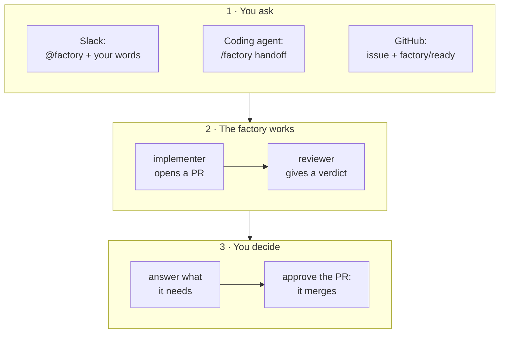

Hand the Agent Factory a small, well-defined fix, and an AI agent turns it into a reviewed pull request
while you keep working. This guide shows you how, from three places: a Slack thread, your coding agent,
or a GitHub issue with a label.

**In a hurry?** Do the one-time [set-up](), then follow
[Get started in five minutes]() on the path you prefer.

## Contents {#contents}

| Chapter | You will be able to |
|---|---|
| 1. [Meet the factory]() | Say what the factory does, and the four rules it keeps |
| 2. [Before your first task]() | Get the five things you need, from the right person |
| 3. [Get started in five minutes]() | Take one task from request to merged pull request, from Slack, your coding agent or GitHub |
| 4. [Write a good task]() | Write a request the agents can finish, and know what may merge on its own |
| 5. [Follow and steer a task]() | Read a room page, leave a note, steer a run, and stay inside the budget |
| 6. [When the factory needs you]() | Answer each kind of need, and know where each is answered |
| 7. [Merging]() | Know why a pull request comes to you, and approve the right commit |
| 8. [From your terminal and coding agent]() | Set up `maku`, hand off side tasks, follow them and check their branches out |
| 9. [Work across repositories]() | Plan one change that spans two repositories |
| 10. [When things go wrong]() | Fix a set-up problem, unstick a task, stop everything, and undo a merge |

Keep the [cheat sheet]() at hand: every label, comment, Slack phrase,
tool and command on one page.

The reference pages behind this guide: [Slack]() for every message
the Slack app sends, [Commands]() for every `maku` command
and tool, and [the merge gate]() for every merge rule.
