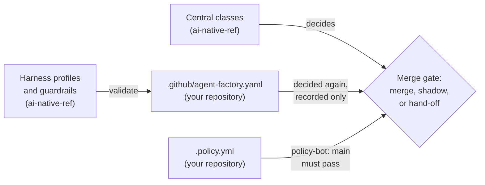

By the end of this chapter you will know where a repository's merge policy lives on this platform,
change a class, and take a shadow class live. It is for maintainers.

**The short version:** the central config in ai-native-ref decides every merge. Your repository's
`.github/agent-factory.yaml` is read, compared and decided again beside it, but not acted on. A class
change that should take effect now goes to the central config, with its policy-bot rule, and the
repository file follows so the two keep agreeing.

Every field, rule and error message is in Maku's
[merge policies guide](https://github.com/Smana/maku/blob/main/docs/merge-policies.md). This chapter is
how that model is set up here.

## How this platform is configured {#configuration}

Six switches under `policyManagement` roll merge policies out, one stage at a time. Example (the
reference host): the factory's switches are in `tooling/base/agent-factory/helm-values-configmap.yaml`,
the broker's in `infrastructure/<cluster>/room-broker/config.yaml`:

| Switch | Set | What it means for you |
|---|---|---|
| `read` | on | The factory compares your repository's file with the central classes |
| `simulation` | on | `maku policy diff` and `maku policy simulate` work, and the editor shows its fixture replay |
| `dualEvaluation` | on | Every merge is decided again under your file, and the record notes whether both agree |
| `promotion` | on, factory and broker | The Settings pages, promotion evidence and promotion requests are served |
| `repositoryAuthority` | off | The central config decides every merge: your file changes no decision |
| `approvalMemory` | off | No saved grants: a file in a live class's `requiresApproval` list always asks a maintainer |

The central config sets no `mergeGuardrails`, so promotion needs the default 20 decisions.

## Where policy lives {#where}

| File | Repository | Holds |
|---|---|---|
| `tooling/base/agent-factory/helm-values-configmap.yaml` | ai-native-ref | The central classes per repository, the `harnessProfiles` a class may name, and the guardrails |
| `.github/agent-factory.yaml` | Your repository | `factory:`, the ownership fence, and the repository's own `classes` |
| `.policy.yml` | Your repository | policy-bot's rules: each class that should merge needs a `low-risk:` rule |



Example (the reference host): cloud-native-ref's file declares the same classes as the central config,
so the comparison reads equivalent. ai-native-ref's file holds `factory:` only: its Settings page
shows the central classes and promotes none of them.

## Change a class {#change-a-class}

A change to what merges needs up to three edits: the central class in ai-native-ref (then a release
and the host's pin bump), the class's `low-risk:` rule in `.policy.yml`, and the same class in
`.github/agent-factory.yaml`. Each touches a gate path, so a maintainer merges it.

### By hand {#by-hand}

You need a `maku` from the release the factory runs: `maku policy` is recent.

1. From an ai-native-ref checkout, write the factory's config to a file, with the cluster's values
   substituted:

   ```bash
   yq '.data["values.yaml"]' tooling/base/agent-factory/helm-values-configmap.yaml | yq '.config' \
     | cluster_name=<factory> private_domain_name=<your-domain> identity_provider_url=https://<idp> \
       envsubst '$cluster_name $private_domain_name $identity_provider_url' > factory.yaml
   ```

2. In your repository, edit `.github/agent-factory.yaml`, then validate it against the default
   branch's copy:

   ```bash
   git show origin/main:.github/agent-factory.yaml > old.yaml
   maku policy diff --config factory.yaml --repository owner/repo old.yaml .github/agent-factory.yaml
   ```

   It prints each class as `unchanged`, `tightening`, or `relaxation` with the reason. An invalid file
   fails with the error and where it is.
3. Open the pull request.

Do not validate with `maku policy check`. It answers "equivalent to the central config", not "valid":
a new class fails it by design. Here it is useful once both edits are in, to confirm the file and the
central config still agree.

### In the Settings editor {#editor}

Open `https://rooms.<your-domain>/settings/merge-policies/<owner>/<repo>` and use the policy editor:

- **Guided form** for one class, or **expert YAML** for the whole file. A template starts a new class.
- **Check** validates on the server, with the gate's own parser, and marks each error on its line.
- The answer shows the structural change per class, the fixture replay, and how strict the class
  would have been on its recent decisions.
- It ends with the whole file and a GitHub edit link, prefilled for the default branch.

The editor never writes the policy. Paste the file into the edit page and open the pull request.

To see why the gate decided as it did on one pull request, open
`/settings/merge-policies/<owner>/<repo>/decisions/<number>`: its decision timeline, in the gate's order.

## The starter policy and templates {#starter}

A repository with no `classes` yet starts from the starter file in Maku's
[Start here](https://github.com/Smana/maku/blob/main/docs/merge-policies.md#start-here):
`docs-links`, `revert` and `docs`, all in shadow. The editor's templates add one class each, in shadow:

| Template | For |
|---|---|
| `docs-broad` | Markdown under `docs/` and the README, with a size cap |
| `deps-patch` | Renovate patch bumps, adopted from Renovate |
| `deps-minor` | Renovate minor bumps; shadow only, it never goes live |
| `generated-files` | Generated files a holdout check regenerates and compares |

Two rules every file with classes meets:

- It declares `docs-links` and `revert`. `mode: off` is allowed; a file's first class in the editor
  brings both as `off`.
- Every `live` or `shadow` class written by the agents declares `allowedFiles`. Without it, any path of
  the repository would be in the class.

## Promote shadow to live {#promote}

A shadow class goes live on its evidence. The class's row on its repository's Settings page shows it.

1. Collect the evidence: at least 20 `shadow_would_arm` decisions you merged unchanged, no bad outcome,
   and one `factory/drill` revert of one of its pull requests.
2. Below 20, request an exception: a lower minimum and a justification of 20 to 2,000 characters. An
   operator in the broker's `policyManagement.operators` approves or refuses it once; an approved one
   lasts 14 days. Example (the reference host): the operator is `Smana`.
3. Click **Promote to live**. The page shows the file with that class's `mode:` line set to `live`,
   and the edit link.
4. Open the pull request yourself, then record its number on the page, and later whether it merged or
   was abandoned.

That pull request changes your repository's file only. For the class to merge on its own here, also
set it live in the central config and add its `low-risk:` rule to `.policy.yml`.

## Limits {#limits}

- **Simulation is a fixture replay.** It replays Maku's conformance fixtures under both classes, which
  proves the editor uses the gate's evaluator. It is not a preview of your repository's pull requests.
- **Merge and create rule** saves a grant and merges nothing: the pull request in front of you still
  needs your approval. Approval memory is off here, so its page is not served.
- **Evidence can be slow to load.** The factory reads 180 days of the class's pull requests from GitHub
  on demand. If the page cannot read it, reload; once read, it is kept 10 minutes.
- **The room pages' headers have no Settings link.** Open the address above.

**Next:** keep the [cheat sheet]() at hand.
