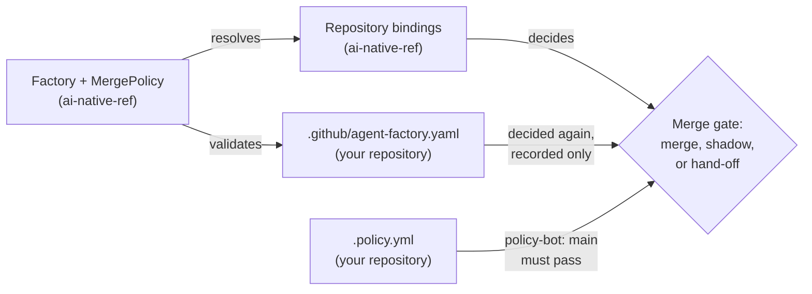

By the end of this chapter you will know where a repository's merge policy lives on this platform,
change a binding, and take a shadow class live. It is for maintainers.

**The short version:** each `Repository` object in `ai-native-ref` binds the `MergePolicy` objects it
uses and decides every merge. Your repository's `.github/agent-factory.yaml` is read, compared and
decided again beside it, but not acted on. A change that should take effect now goes to the
`Repository` binding, with its policy-bot rule in `.policy.yml`, and the repository file follows if it
lists bindings.

Every field, rule and error message is in Maku's
[merge policies guide](). This chapter is how that model is set up
here.

## How this platform is configured {#configuration}

One setting rolls merge policies out: `policyManagement.stage`, at `manage` on the factory and on the
broker. Example (the reference host): the factory's is in `tooling/base/agent-factory/helm-values-configmap.yaml`,
the broker's in `infrastructure/<cluster>/room-broker/config.yaml`. At `manage`:

| What runs | What it means for you |
|---|---|
| The comparison | The factory compares your repository's file with the central bindings |
| The offline verbs | `maku policy diff` and `maku policy simulate` work, and the editor shows its fixture replay |
| Dual evaluation | Every merge is decided again under your file, and the record notes whether both agree |
| The Settings pages | The bindings editor, promotion evidence and promotion requests are served |
| Approval grants | Consulted; no policy here declares `requiresApproval`, so none is asked for |

The central objects decide every merge: no repository sets `classAuthority: repository`, so your file
changes no decision.

Example (the reference host), the bound policies and modes in `tooling/base/agent-factory/resources/repository-*.yaml`:

| Repository | `live` | `shadow` | `disabled` |
|---|---|---|---|
| `Smana/cloud-native-ref` | `docs-links`, `revert` | `alert-rules`, `dead-links`, `deps-patch`, `deps-minor` | `docs`, `tests`, `dashboards`, `scripts`, `review` |
| `Smana/ai-native-ref` | — | `docs-links`, `revert`, `dead-links` | `docs`, `tests`, `dashboards`, `scripts` |
| `Smana/runlore-kb` | — | `docs-links`, `revert`, `kb-entries` | — |
| `Smana/runlore` | — | `docs-links`, `revert` | — |

The central config sets no `mergeGuardrails`, so Maku's defaults hold every bound class: `.github/`,
`.policy.yml` and `CODEOWNERS` are never merged unattended, and a class allows at most 10 files,
300 changed lines and 5 merges a day. A binding above one of these is refused as `GuardrailMismatch`.

A `factory/hold` label on a pull request hands it to a maintainer before any class is read; removing
the label returns it to the gate.

## Where policy lives {#where}

| File | Repository | Holds |
|---|---|---|
| `tooling/base/agent-factory/resources/mergepolicy-<class>.yaml` | ai-native-ref | One class's definition, a `MergePolicy` object every repository that uses the class binds |
| `tooling/base/agent-factory/resources/repository-<name>.yaml` | ai-native-ref | One `Repository` object: its `merge` rules and `spec.mergePolicies` bindings (`name`, `mode`, parameters) |
| `tooling/base/agent-factory/resources/factory.yaml` | ai-native-ref | The `Factory` object: `harnessProfiles`, `mergeGuardrails` and shared `mergeDefaults` |
| `.github/agent-factory.yaml` | Your repository | `factory:`, the ownership fence, and optional `mergePolicies:` bindings for dual evaluation |
| `.policy.yml` | Your repository | policy-bot's rules: each class that merges unattended needs a `low-risk:` rule |



Example (the reference host): `cloud-native-ref`'s `.github/agent-factory.yaml` binds the same
`mergePolicies` as `tooling/base/agent-factory/resources/repository-cloud-native-ref.yaml`, so the
comparison reads equivalent. `ai-native-ref`'s file holds `factory:` only, so its Settings page shows
the `Repository`'s bound classes.

## Change a class {#change-a-class}

<span id="starter"></span>

A class is a `MergePolicy` object, and each repository binds it under `Repository.spec.mergePolicies`
with a `name`, a `mode` (`live`, `shadow` or `disabled`) and the parameters the policy leaves to the
repository. The factory reads `MergePolicy` and `Repository` objects live: once Flux applies the
change, the next decision uses it without a pod restart.

Example (the reference host), from `tooling/base/agent-factory/resources/repository-cloud-native-ref.yaml`:

```yaml
spec:
  mergePolicies:
    - {name: docs-links, mode: live, holdoutChecks: ["Check the documentation links 🔗"]}
    - {name: revert, mode: live, holdoutChecks: ["Check the documentation links 🔗"]}
    - {name: docs, mode: disabled}
    - name: dead-links
      mode: shadow
      allowedFiles: ['^(docs|website/content)/.+\.md$']
      oracleWorkflow: dead-links.yaml
```

Two rules every repository's policy bindings meet:

- They bind `docs-links` and `revert` (`mode: disabled` is allowed).
- Every `live` or `shadow` binding resolves with `allowedFiles` or a `diffShape` (`docs-links` and
  `revert` carry theirs). Without either, any path in the repository would match, and the factory
  refuses the binding as `Unbounded`.

### By hand {#by-hand}

You need a `maku` binary at the pinned version ([status page]()).

1. Edit the binding in `tooling/base/agent-factory/resources/repository-<name>.yaml` (and
   `tooling/base/agent-factory/resources/mergepolicy-<class>.yaml` when the policy itself changes), then
   validate the assembled objects ([factory configuration]()):

   ```bash
   task factory-config
   ```

2. When your repository mirrors its bindings under `mergePolicies:` in `.github/agent-factory.yaml`,
   check the change against the default branch:

   ```bash
   python3 scripts/ci/factory_config.py config <factory> > factory.yaml
   git show origin/main:.github/agent-factory.yaml > old.yaml
   maku policy diff --config factory.yaml --repository owner/repo old.yaml .github/agent-factory.yaml
   ```

   It prints each class as `unchanged`, `tightening`, or `relaxation` with the reason, and fails with
   the line on an invalid file.
3. When taking a class `live`, add its `low-risk:` rule to `.policy.yml`, then open the pull requests.
   Every file above is a gate path, so a maintainer merges each one.

Do not validate a draft change with `maku policy check`. It tests equivalence with the central bindings,
so a new edit fails until both sides match.

### In the Settings editor {#editor}

Open `https://rooms.<your-domain>/settings/merge-policies/<owner>/<repo>` to use the **Bindings
editor** (`/settings/merge-policies/policies/<name>` shows and previews one `MergePolicy` object):

- Edit a binding's `mode` and repository parameters; the policy's own definition stays read-only on the
  repository page.
- **Check** validates on the server with the gate's parser and returns the `Repository` manifest
  (`repository-<name>.yaml`), marking each binding resolved or refused with its reason.
- The editor writes nothing: commit the manifest to `tooling/base/agent-factory/resources/` in a pull
  request.

To see why the gate decided as it did on one pull request, open
`/settings/merge-policies/<owner>/<repo>/decisions/<number>`: its decision timeline, in the gate's order.

## Promote shadow to live {#promote}

A shadow class goes live on its evidence. The class's card on its repository's Settings page shows it.

1. Collect the evidence: at least 20 `shadow_would_arm` decisions you merged unchanged (5 for a policy
   at `evidence: low`; none is here), no bad outcome, and one merged `factory/drill` revert in the
   repository.
2. Below the minimum, request an exception: a lower minimum and a justification of 20 to 2,000 characters. An
   operator in the broker's `policyManagement.operators` approves or refuses it once; an approved one
   lasts 14 days. Example (the reference host): the operator is `Smana`.
3. Click **Promote to live**. Under central authority, the page proposes `repository-<name>.yaml` with
   that binding's `mode:` line changed from `shadow` to `live`.
4. Open the pull request in `ai-native-ref` (and add the class's `low-risk:` rule to `.policy.yml`),
   then record the pull request number on the page, and later whether it merged or was abandoned.

## Limits {#limits}

- **Simulation is a fixture replay.** `maku policy simulate` replays Maku's conformance fixtures with
  the gate's evaluator. It is not a preview of your repository's past pull requests.
- **Merge and create rule** saves an approval grant and merges nothing: the pull request in front of you
  still needs your approval. No policy here declares `requiresApproval`, so no grant is asked for.
- **Evidence can be slow to load.** The factory reads 180 days of the class's pull requests from GitHub
  on demand. If the page cannot read it, reload; once read, it is kept 10 minutes.
- **The room pages' headers have no Settings link.** Open the address above.

**Next:** keep the [cheat sheet]() at hand.
