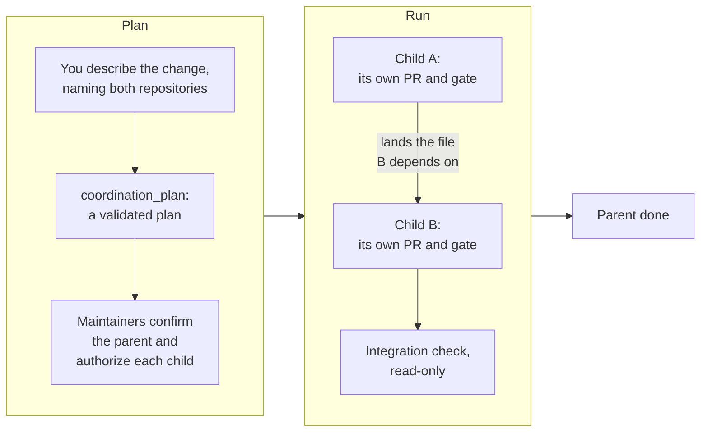

By the end of this chapter you will know how the factory treats one change across two repositories, and
what you can do with a coordination plan.

A task never spans two repositories: each has its own maintainers, branch rules and merge gate. A change
that needs both, such as a new field in a library and the service that reads it, becomes a
**coordination**: a family of ordinary tasks, one per repository, held together by a plan.

## What a coordination plan holds {#plan}

| Part | What it is |
|---|---|
| **Parent** | The issue and room that record the change. It never writes code, opens a pull request or merges |
| **Children** | One ordinary task per repository, at most two, each with its own maintainer, branch, gate and pull request |
| **Dependency** | A file the first child lands, which the second waits for before it starts |
| **Integration check** | A read-only run that checks the two merged changes work together |
| **Ceiling** | Each child's allocation, from its class's own budget |



## Ask for a plan {#ask}

From your coding agent, describe the change and name both repositories:

```text
Plan a coordination: add a `retryAfter` field to the webhook payload
in owner/library, and make owner/service honour it.
Primary repository: owner/library.
```

Where your platform turns coordination on, your agent has a `coordination_plan` tool and calls it. It
answers with the plan, its hash and any diagnostics, such as a
maintainer it had to guess. Read it as you would a proposal: the children, what each one changes, the
acceptance check of each, and the dependency between them.

A coordination plan files nothing: no issue, no task, no run, no label. Both repositories must be public
and on the planner's list, and you must be able to write the primary.

Example (the reference host): the planner's list names `Smana/ai-native-ref` and `Smana/runlore-kb`, so a
plan may span those two.

## Confirm and run {#confirm}

A plan becomes work only when a maintainer of the primary confirms the parent, and each child's
maintainer authorizes their part. The parent's room shows these as needs, with **Confirm**,
**Authorize** and **Decide** in its coordination panel
([chapter 6]()).

In *plan mode*, the factory accepts drafts and confirmations but starts no child: it records the
family and stops there. Whether *execute mode*, which files the children and runs them, is on where you
are: the [status page]().

To read every child's branch at the exact commit the parent names:

```bash
maku coordination checkout <parent>
```

There is no automatic rollback across repositories. If a child's merge must be undone, revert it in its
own repository, as for any task ([chapter 7]()).

**Next:** [chapter 10]() covers what to do when something goes
wrong.
