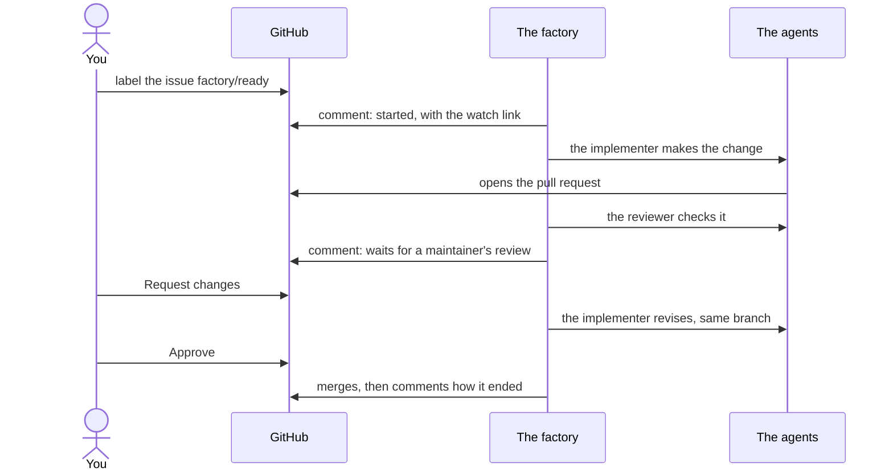

By the end of this chapter you will have written an issue the factory can finish, handed it over, and
merged its pull request.

## Write an issue the factory can finish {#write-an-issue}

The agent reads your issue and nothing else. It cannot ask you what you meant halfway through, so the
issue is the whole brief.

Keep to one defect per issue, and give it four things:

1. **A title with an area**, such as `docs:` or `fix(scripts):`.
2. **What is wrong**, with the file or page where you saw it.
3. **What it should be.**
4. **An `## Acceptance check` section**: how anyone can tell the work is done. It matters most: the
   agents check their work against it.

```markdown
docs: the logging page lists the wrong chart version

The page docs/observability/logs.md says version 0.13.9.
The repository pins 0.13.10.

It should say 0.13.10, the version the repository pins.

## Acceptance check
- docs/observability/logs.md names 0.13.10.
- No other page names 0.13.9 for this chart.
```

## Hand it over {#hand-it-over}

Put the label `factory/ready` on the issue. That is the whole hand-over.

The factory takes a copy of the issue as it is now. An edit you make later counts only once you remove
the label `factory/ready` and put it back.

It then sorts the task: its **class** is the kind of change (`docs`, `scripts` and so on), and its
**tier** is how much time and money each run may spend. The factory picks both from the issue; you do
not choose them. Within a minute it comments on the issue:

```text
Agent factory task `<task>` started run `<run>` (implementer) on branch `agent/<task>`.

- Budget: 1.5 M tokens, 45 minutes (tier standard)
- Watch: https://rooms.example/r/<task> (tailnet only)
- Stop: apply the label `factory/stop`
```

The budget is in tokens, the units models bill by, and minutes. The *watch* link opens the task's room,
which [chapter 4]() tours.

## The agents work {#agents-work}

An agent called the implementer makes the change on the branch `agent/<task>` and opens a pull
request. The factory comments on the issue with its link.

A second agent, the reviewer, reads the pull request against your acceptance check. It posts its
verdict as one comment on the pull request. For a change that may merge on its own, the reviewer must
approve; for every other change, its verdict is advice for you.

If CI fails, the implementer comes back and fixes it on the same branch. When everything is green, the
factory comments that the task waits for a maintainer's review. That is your cue.

## You review {#you-review}

Review the pull request on GitHub, as you would a colleague's.

If something is off, submit a review with **Request changes** and say what you want. The factory
comments that it is revising. A new implementer run starts on the same branch, with your review as its
instructions, and pushes a new commit.

When you are happy, **approve** it from GitHub's web page, once the room shows no run in progress
([why]()). Your approval is the
merge: within a minute, the factory's merge bot merges the commit you approved. If it cannot, it
comments why, and [chapter 5]() tells
you what to do.

The factory closes the task with a last comment: how it ended and how many tokens it used.



**Next:** [chapter 4]() shows you how to follow a task as it
runs, and how to steer or stop it.
