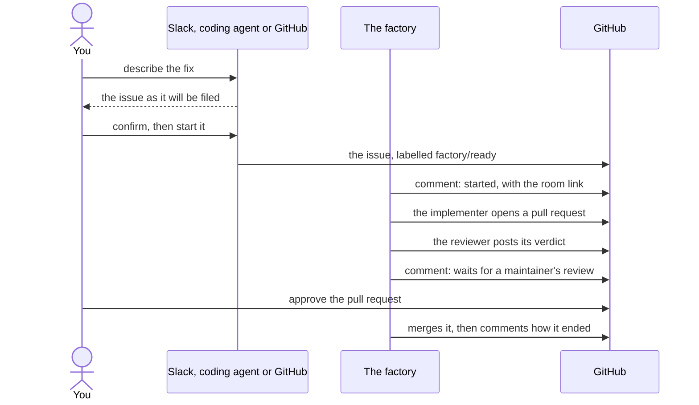

By the end of this chapter you will have handed the factory one small fix and merged its pull request.
Pick the path that matches where you are when you spot the fix; all three end at the same pull
request.

| You are in | Path | You need |
|---|---|---|
| A Slack conversation | [Slack](#paths) | Your Slack user linked, a channel the app serves |
| Your coding agent (Claude Code, OpenCode, Codex…) | [Coding agent](#paths) | `maku` installed and set up for your agent |
| GitHub | [GitHub issue](#paths) | Maintainer rights on the repository |

Your five minutes are the request and the review. The agents' work in between takes ten to twenty
minutes, and you do not have to watch it.



## Pick your path {#paths}




**1. Link your Slack user, once.** In a channel the app serves, mention `@factory link`. The app sends
you, and only you, a one-time page. Open it, sign in, check the Slack user and the GitHub login are yours,
and press **Link**.

**2. Ask in your own words.** Mention the app with what is wrong and what it should be. Name the file
when you know it.

<!-- example -->
```text
@factory docs/runbooks/agent-factory/22-slack.md links to
18-factory-interface.md, which does not exist.
It should link to 18-factory-interfaces.md.
```

**3. Read the proposal.** Within a few seconds the app answers in the thread with one message, the
proposal. Example (the reference host):

```text
Proposal v1 · sha256:5e0c9a41… · by @you

Repository
Smana/ai-native-ref
- docs/runbooks/agent-factory/22-slack.md is the page that carries the link

Issue
"docs: runbook 22 links to a runbook that does not exist"
What is wrong: docs/runbooks/agent-factory/22-slack.md links to
18-factory-interface.md, which does not exist.
What it should be: the link points at 18-factory-interfaces.md.
Acceptance check: the link resolves, and the link check passes.
class docs-links

Roles
scoper, implementer, reviewer · one issue: a plan with more is filed
from your coding agent or the web UI

Ceiling
$2.00 (class:docs-links.taskUSD)

Editing
Edit issues is a reply: write what should change in this thread and
the plan is drafted again from your words. Confirm, or a ✅ reply or
reaction, files it as shown; Cancel closes it.

[ Confirm ]  [ Cancel ]
```

Check the **Issue** section before anything else: it is exactly what will be filed, and the agents
read nothing else. The planner writes it from your words and does not check them against the
repository, so a wrong fact in your mention becomes a wrong issue.
[Chapter 4]() shows a request that went wrong.

**4. Change it by replying.** Reply in the thread, for example `the acceptance check should also say
no other page links to the old name`. The same message updates in place, and the sections that moved
are marked `‹changed›`.

**5. Confirm.** A maintainer presses **Confirm**, or reacts ✅. The message becomes the filed line:

```text
Filed #N for @you, sponsored by GitHub @your-login; the factory starts it.
Room: https://rooms.example/r/<room>
```

**6. Follow it in the thread.** The thread posts `Triaged.`, then `Pull request #… opened.`, then
`The work waits for a human (…)`. Reply `status`, `needs me` or `the pull request` at any time.
Nothing you type in the thread reaches the agents.

**7. Approve on GitHub.** Open the pull request, read it, approve it. The merge bot merges the commit
you approved within a minute, and the thread posts `#… merged.`

Every message the app can send, and every refusal with its fix, is on the
[Slack page]().




**1. Set up, once.** Install `maku` ([chapter 8]()),
then connect it to your agent and check:

```bash
maku setup claude      # or opencode, codex, gemini, cursor, copilot
maku doctor            # every line should read ok
```

**2. Hand it off.** You are in the middle of other work and spot the bug. Tell your agent:

```text
/factory handoff test-storage-dashboard.py finds no dashboard when the
repo is checked out under .claude/: it matches SKIP against the absolute path
```

**3. Read the draft.** Your agent reads the code, then writes the issue in the template's three
sections and has the factory check it (`issue_draft`). Example (the reference host), issue #2759 in
`Smana/cloud-native-ref`:

```markdown
ci(tests): test-storage-dashboard finds no dashboard under .claude/

## What is wrong
scripts/ci/tests/test-storage-dashboard.py:35 tests the absolute path
against SKIP. Under a directory named `.claude`, every dashboard path
contains `.claude`, so the walk finds nothing and the test fails with
"found 0". CI passes only because its checkout path has no `.claude`.

## What it should be
SKIP is matched against the path relative to the repository root. The
test finds the same dashboards from any checkout location.

## Acceptance check
`git worktree add .claude/worktrees/t HEAD && python3
.claude/worktrees/t/scripts/ci/tests/test-storage-dashboard.py` exits 0,
and the same test from the normal checkout still exits 0.
```

The check answers `canStart: true` when you may start the factory on that repository.

**4. Confirm, then start it.** Your agent calls `issue_file`, which asks you to confirm in a form.
Answer **file: yes**, and **start: yes** if the form offers it: the issue is filed with your own `gh`,
as you, and labelled `factory/ready`.

When your agent cannot show forms, `issue_file` hands back one command instead. Run it yourself, then
add the label:

```bash
gh issue create --repo=owner/repo --title='ci(tests): …' --body-file=- <<'EOF'
…
EOF
gh issue edit <number> --repo owner/repo --add-label factory/ready
```

Your agent never applies the label on its own: starting the factory is your decision.

**5. Let your agent follow it.** Once the task starts, your agent runs `room_wait` in the background
and tells you when the room needs you, opens a pull request or ends. You keep working. Example (the
reference host), what it reports when the pull request is ready:

```markdown
### gmmrmund · #2759 ci(tests): test-storage-dashboard finds no dashboard …
**needs you** · waiting for a human · Smana/cloud-native-ref
[open the room](https://rooms.example/r/gmmrmund)

| | |
|---|---|
| Run | reviewer · succeeded |
| Spend | $0.16 of $5.10 (3 %) |
| PR | #2760 · reviewer approved |
```

The implementer took about nine minutes and the reviewer about two; the whole task cost $0.16.

**6. Try the branch, if you want.** Ask your agent to check it out (`room_checkout`). The branch lands
in a new worktree beside your repository; your own checkout is untouched.

**7. Approve on GitHub.** Open the pull request, read the diff and the reviewer's verdict, and approve.
The factory comments `is done: the pull request was merged` with the tokens it used.




**1. Write the issue.** One defect, in three sections. [Chapter 4]()
covers what makes one good.

```markdown
docs: the logging page lists the wrong chart version

## What is wrong
docs/observability/logs.md says version 0.13.9. The repository pins 0.13.10.

## What it should be
The page says 0.13.10, the version the repository pins.

## Acceptance check
- docs/observability/logs.md names 0.13.10.
- No other page names 0.13.9 for this chart.
```

**2. Label it `factory/ready`.** That is the whole hand-over. Only a maintainer's label counts, and the
factory reads the issue as it is at that moment.

**3. Read the factory's comments.** Within a minute it comments on the issue. Example (the reference
host), the comments on issue #2759:

```text
Agent factory task `gmmrmund` started run `tabl4eue` (implementer)
on branch `agent/gmmrmund`.

- Budget: 1.5 M tokens, 45 minutes (tier standard)
- Watch: https://rooms.example/r/gmmrmund (tailnet only)
- Stop: apply the label `factory/stop`

Run `tabl4eue` of task `gmmrmund` opened #2760.

Agent factory task `gmmrmund` started run `sitjutqz` (reviewer)
on branch `agent/gmmrmund`.

Agent factory task `gmmrmund` waits for a maintainer's review: the policy
needs a maintainer's approval.

To merge: approve this pull request (a GitHub review by a maintainer). The
merger merges the approved head within a minute, or says why not.
```

The **Watch** link opens the task's room ([chapter 5]()).

**4. Read the reviewer's verdict.** The reviewer posts one comment on the pull request:

```text
### Agent review: approved

Reviewed commit 8a1d66b0. The diff is a single-line change …
Both acceptance checks verified … No other files touched,
no changes to protected paths. No gaps found.
```

The verdict is advice. It neither approves nor blocks the pull request.

**5. Review and approve.** Request changes if something is off: a new run revises the same branch,
with your review as its instructions. Approve when you are happy, once no run is in progress. The
merge bot merges the commit you approved, and the factory closes the task:

```text
Agent factory task `gmmrmund` is done: the pull request was merged.

Tokens used: 433 k.
```




## What just happened {#agents-work}

Whichever path you took, the factory did the same five things:

1. **Took a copy of the issue** when it was labelled. An edit you make later counts only once you
   remove `factory/ready` and put it back.
2. **Sorted the task**: its *class*, the kind of change, and its *tier*, how much each run may spend.
   You do not pick either; [chapter 4]() explains them.
3. **Ran the implementer** on the branch `agent/<task>`. It checks its work against your acceptance
   check and opens the pull request. If CI fails, it comes back and fixes it.
4. **Ran the reviewer**, which reads the pull request against the acceptance check and posts its
   verdict.
5. **Handed it to you** with one comment saying what to do. Your approval is the merge.

## You review {#you-review}

Review the pull request on GitHub, as you would a colleague's.

- **Something is off:** submit a review with **Request changes** and say what you want. The factory
  comments that it is revising, and a new implementer run pushes a new commit to the same branch.
- **It is right:** approve it once the room shows no run in progress. If an agent pushes while you read,
  approve again: the merge bot merges only the commit you approved
  ([why]()).

When the merge bot cannot merge, it comments why, and [chapter 7]()
tells you what to do.

**Next:** [chapter 4]() shows how to write a task the agents
finish on the first try.
