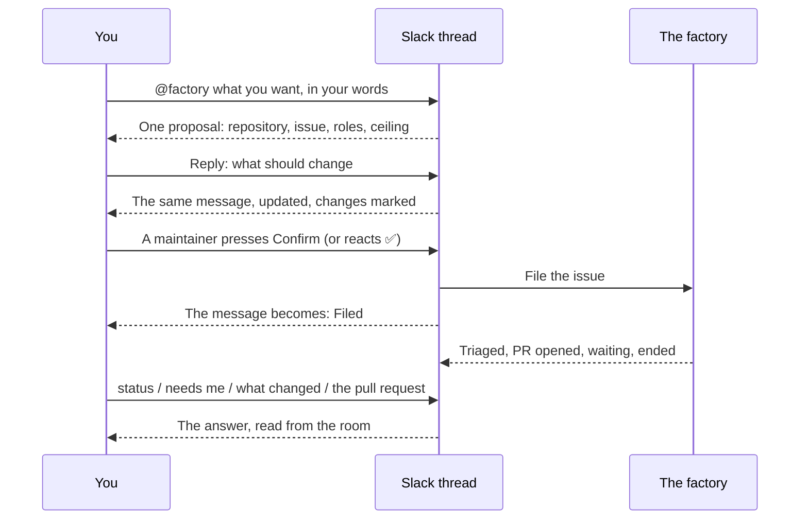

`maku-slack`, Maku's Slack app, turns a Slack thread into a factory task. Whether it is deployed on your
platform is on the [status page](). A mention in your own words is planned
into one proposal message, and a reply changes it. A maintainer's Confirm files it and starts the task; the
thread then follows the room and answers five questions about it. Steering stays on the room page, and so
does every approval except a push; the merge is your approval on GitHub.

| Step | Do this |
|---|---|
| Once | Mention `@factory link` in a served channel and confirm the one-time page it answers you with. `@factory unlink` undoes it |
| Ask | `@factory` and what you want, in your own words |
| Change | Reply in the proposal's thread. The same message updates in place |
| Confirm | A maintainer presses **Confirm** (or reacts ✅). The issue is filed, the task starts, and the thread shows its triage, pull request and end |
| Ask the thread | Reply `status`, `needs me`, `what changed`, `the pull request` or `stop` |
| Act | Approve a `forge.push` from the card in the thread (two buttons), or open the room page for every other approval, an answer or a steer; approve the pull request on GitHub to merge it |

Setting it up (the Slack App, its keys, the machine user, the channels it serves) is the operator's:
[runbook 22](https://github.com/Smana/ai-native-ref/blob/main/docs/runbooks/agent-factory/22-slack.md),
and [runbook 18](https://github.com/Smana/ai-native-ref/blob/main/docs/runbooks/agent-factory/18-factory-interfaces.md)
for the sponsored principal and the webhooks it rides on.



## Link your Slack user, once

Before your Confirm or ✅ files anything, the factory must know whose GitHub account you are. Mention **`@factory link`** in
a served channel: the App answers **only you** with a one-time link (valid 10 minutes, never send it to anyone).
Open it, sign in to the rooms page, and press **Link** after checking that the Slack user and your GitHub login
are yours. Your Confirm then files in the name of your **current** GitHub login, and only if it is a maintainer of the
repository. **`@factory unlink`** removes the link. Someone the operator lists in git keeps that entry.

## Write a mention

A mention is your own words, in a channel the App serves. There is no template and no keyword to learn:
say what is wrong and what you want instead.

```text
@factory the install link in the README is dead, it should point at the current install page
```

The App passes your words to the factory's planner, which answers with **one proposal message** in your
thread:

| Section | What it holds |
|---|---|
| Header | The revision, its check hash and who asked; it also says when a template, not the planner, wrote the draft |
| Repository | The repository the issue goes to, with the evidence for it, and any other repository this channel serves that could also fit |
| Issue | The title, what is wrong, what it should be and the acceptance check, as they will be filed, and the class |
| Roles | Who works on it, in order |
| Ceiling | The most the task may spend, and where that figure comes from |
| One question | Only when the planner needs to know something first, such as which repository you mean: the question and its recommended answer |
| Editing | How to change it, confirm it or cancel it |

The planner reads public repositories only, and it plans one issue per thread.

## Change the proposal

Reply **in the proposal's thread**: write what should change, or answer its one question. Only the person
who wrote the mention can change it, and only until it is filed.

- The **same message** updates in place; nothing new is posted below it.
- The sections that changed are marked `‹changed›`.
- When the change touches what gets filed (the repository, the issue, its class, the roles or the
  ceiling), the header says `requires a new confirmation`: a Confirm pressed earlier does not cover it.
- Naming another repository in your words moves the plan there, if this channel serves it.

A proposal has at most 40 revisions: the first, and up to 39 changes. When Slack refuses to edit the message, the App posts the new
revision below and the old message says `This proposal was replaced below.`, with no buttons.

## Confirm it

A **maintainer presses Confirm** under the proposal. A ✅ does the same thing, as a reaction on the
proposal or as a reply that is only ✅: the same checks, the same filing.

The message then becomes the Filed line, and its buttons are gone:

```text
Filed #N for @you, sponsored by GitHub @login; the factory starts it. Room: …
```

One issue per thread, and once filed the thread files nothing more. A ✅ on the Filed line, or a reply
that is only ✅, is ignored. A press on an older copy of the proposal answers
`Not filed: this thread's task is already filed or cancelled; mention me again to plan another.`
If the factory already holds a task for the thread, the Filed line says `Already filed:` with the room link.

**Cancel** is the author's, and starts nothing. The message becomes
`Proposal cancelled by @you; mention me again to plan another.` Anyone else who presses it is told that
only the author cancels, and that a maintainer confirms.

Then the thread shows, in this order:

| Line | Means |
|---|---|
| `Triaged.` | The work is under way |
| `Pull request #… opened.` / `A review verdict is on #…` | A PR is ready for review |
| `The work waits for a human (…)` | The run needs an answer or an approval: the card in this thread for a push, the room page for everything else |
| `#… merged.` / `#… reverted.` | The PR landed or was undone |
| `A budget was reached (…)` | The run hit its cap and stopped |
| `Ended, state: …` | The room is closed |

A run starting posts no line: it is not news. Which of these lines a channel posts is the operator's
choice.

## Ask the thread

Once the task is filed, reply in its thread with one of five questions. The App reads the answer from the
room the Filed line names, never from the thread:

| Ask | You get | The link goes to |
|---|---|---|
| `status`, `how is it going`, `where is it` | The task's phase and its issue | The room page |
| `needs me`, `what needs me` | One line per thing waiting on a person, with what to do, or `Nothing waits on this task right now.` | Where each one is done |
| `what changed`, `what has changed` | The ten newest milestones, then `More: the room page` when there are more | Each milestone's page |
| `the pull request`, `pr`, `the pr` | The pull request's number, or `No pull request yet in this room.` | The pull request |
| `stop`, `stop it`, `how do i stop it` | Where stopping happens: the `factory/stop` label on the issue is yours to apply, or use Stop on the room page | The room page |

Case and a closing `?`, `.` or `!` do not matter. Anything else is answered with where progress, approvals
and steering are, and the questions you can ask. **Nothing you type in the thread reaches the run**: the
thread answers, it never steers, approves or stops anything.

## Approve a push from the thread

Some runs stop to ask whether they may push to their branch. That approval — a `forge.push` — arrives
as a card in the thread with **Approve** and **Deny**: the kind of approval, the branch it pushes to,
the approval's id, its deadline and the link to the room. The card shows no commit, because the push
happens after you decide: you meet the commit in the pull request.

Three things must hold for your press to count. You own the room or you are one of its approvers; your
GitHub account can write the repository; and, when four-eyes is on, you are not the person who prompted
the run.

A refusal is one line, and only you see it: your Slack user is not linked, you are not an approver, your
GitHub account cannot write there, four-eyes applies to you, the deadline passed, or someone decided
first. Each line names the next move.

**Merging is still your review on GitHub.** A push approval releases exactly one push and never a merge.
Every other approval, and every answer or steer, stays on the room page.

## What needs you, and where

| Need | Where |
|---|---|
| Merge a pull request | GitHub: approve its current head |
| Approve a push to the branch | The card in the thread ([above](#approve-a-push-from-the-thread)), or the room page |
| Approve any other step, answer a question, steer or stop | The room page (the link in the thread). Nothing you write in the thread reaches the run |
| Change the proposal | The proposal's thread, before it is confirmed |
| See where the task is | Ask the thread ([above](#ask-the-thread)) |

## When it says no

| You see | Why | Fix |
|---|---|---|
| `Not proposed: the planner reads public repositories only; …` | The work is in a private repository | Use your coding agent (`issue_draft` then `issue_file`) |
| `Not proposed: the plan service is unavailable; mention me again in a minute.` (or `did not answer in time`) | A passing failure of the planner | Mention again in a minute |
| `Not proposed: the plan service answered something that is not a plan; …` | The planner's answer failed its check | Mention again, or hand it off from your coding agent |
| `Proposal not posted: this plan covers N issues and Slack files one: …` | Your request needs more than one issue | Split it into one mention per issue, or use your coding agent or the web UI |
| `Proposal not posted: the plan is too long for Slack; …` | The plan does not fit in a Slack message | Shorten the request, or use your coding agent or the web UI |
| `Not proposed: that request is longer than 16 KB; …` | Your mention and replies are over the limit | Hand it off from your coding agent or the web UI |
| `Not proposed: this channel serves … and you may file in none of them; …` | The factory accepts none of the channel's repositories from you | Ask the operator for one you may write in |
| `Not proposed: … cannot write to …` | Your GitHub account cannot write to the channel's repositories | Ask the operator for one you may write in |
| `Not proposed: … is not linked to a GitHub account here; …` | Your Slack account is not linked | Mention `@factory link` and confirm the page it answers ([above](#link-your-slack-user-once)) |
| `Not proposed: you have used today's plans; …` | Your plans for the day are spent | Mention again after 00:00 UTC, or hand it off from your coding agent |
| `Not proposed: GitHub could not confirm the repository, …` | GitHub did not answer the repository check | Mention again in a minute |
| `This proposal was planned the most it can be here: …` | You replied to a proposal at its 40th revision | Confirm it, or start a new mention |
| `Not proposed: this thread has all the revisions one proposal may have; …` | You mentioned the App again in a thread whose proposal is at its 40th revision | Confirm it, or start a new mention |
| `This deployment does not plan from Slack yet; …` | The operator has not turned the planner on | Ask the operator |
| `Not filed: … is not linked to a GitHub account here; …` | Your Slack account is not linked to a GitHub login | Mention `@factory link` and confirm the page it answers ([runbook 22](https://github.com/Smana/ai-native-ref/blob/main/docs/runbooks/agent-factory/22-slack.md#6-who-may-file)) |
| `Not filed: … is not a maintainer of …; a maintainer must confirm it.` | Your linked login is not a maintainer | A maintainer confirms instead |
| `Not filed: a newer revision of this proposal is in this thread; …` | You pressed an older message | Press the newest proposal's buttons |
| `Not filed: the plan changed after this was drawn; mention me again to re-plan it.` | The plan no longer matches what the message showed | Mention again to re-plan it |
| `Not filed: the Slack App's budget for today is spent; …` | The App's day budget is spent | Try again the next day, or ask the operator |
| `Not filed: the factory's daily task cap is reached; …` | The factory has started all the tasks it may for the day | Try again after 00:00 UTC |
| `Not filed: the factory is paused (kill switch); …` | An operator paused the factory | Try again once it is resumed |
| `Not filed: the factory does not take tasks on … from Slack; …` | The factory does not accept that repository from Slack | Ask the operator ([runbook 22](https://github.com/Smana/ai-native-ref/blob/main/docs/runbooks/agent-factory/22-slack.md#5-declare-the-channel-in-git)) |
| `Not filed: the factory could not be reached; press Confirm again to retry.` (`react again to retry` after a ✅) | A passing failure | Press Confirm, or react, again |
| Nothing at all | The channel or repository is not served, or the bot is not in the channel | Invite `@factory`, check the channel with the operator |

A `Not filed:` line after Confirm goes to the person who pressed it alone; after a ✅ it is said in the
thread.

The link needs your GitHub account linked to your ZITADEL user ([who sees a room]()); it
grants nothing a maintainer of the repository did not have.

The task is filed by the factory App, with no label and a footer naming its sponsor; its Task names the
App and you. Its budget is the proposal's ceiling, at most the channel's `maxCostUSD`.

Example (the reference host): the App serves one channel, for `Smana/cloud-native-ref` and
`Smana/ai-native-ref`, with a `maxCostUSD` of 2.
