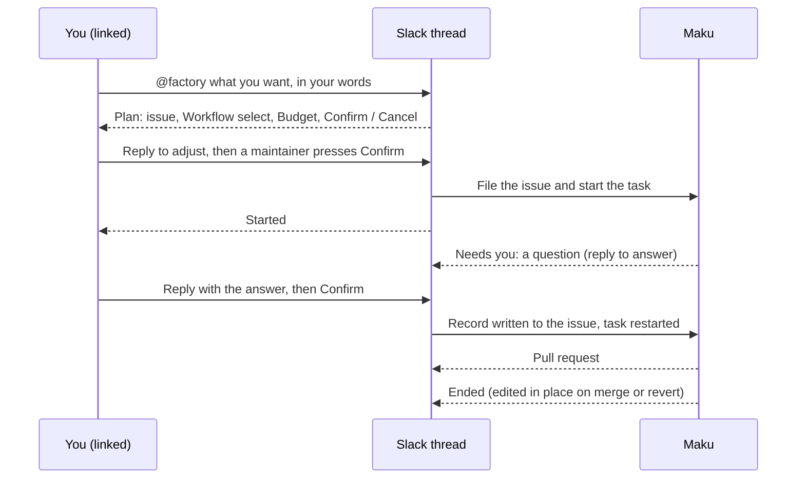

`maku-slack`, Maku's Slack app, turns a Slack thread into a task ([status page]()).
A mention in your own words becomes one plan message showing the issue, the workflow and the budget. A
maintainer's **Confirm** files and starts the task; the thread posts four lines over the task's life,
answers questions, and lets you allow a push, answer the scoper's question, or stop and retry the task.

| Step | Do this |
|---|---|
| Once | Mention `@factory link` in a served channel and confirm the one-time page (`@factory unlink` removes it) |
| Ask | `@factory` and what you want, in your own words |
| Change | Reply in the plan's thread, or pick another workflow in the select; the message updates in place |
| Confirm | A maintainer presses **Confirm** (or reacts ✅) to file the issue and start the task |
| Follow | Four lines: started, needs you, pull request opened, and one end line edited in place on merge or revert |
| Ask the thread | Reply `status`, `needs me`, `what changed`, `the pull request` |
| Act | Allow a `forge.push` on its card, reply to answer a question, or type `stop` / `retry` (or press the button) and confirm |

Operator setup lives in [runbook 22](https://github.com/Smana/ai-native-ref/blob/main/docs/runbooks/agent-factory/22-slack.md)
and [runbook 18](https://github.com/Smana/ai-native-ref/blob/main/docs/runbooks/agent-factory/18-factory-interfaces.md);
every message and refusal line is in Maku's [Slack guide]().



## Link your Slack user, once {#link-your-slack-user-once}

Before the planner answers your mention or your **Confirm** acts, Maku must know your GitHub account.
Mention **`@factory link`** in a served channel: the app sends **only you** a one-time link (valid
10 minutes) and requires your GitHub account to be linked to your sign-in
([access]()). Open it, check that the Slack user
and GitHub login are yours, and press **Link**. **`@factory unlink`** removes the link.

## Plan and confirm a task {#write-a-mention}

Mention `@factory` in a served channel in your own words:

```text
@factory the install link in the README is dead, it should point at the current install page
```

The planner answers with **one plan message** in your thread:

```text
Plan for Smana/ai-native-ref (revision 1)
docs: the install link in the README is dead
Workflow  [ standard (implementer, reviewer) ▾ ]
Budget    up to $2.00
[ Confirm ]  [ Cancel ]
```

- **Workflow and budget.** The plan shows the issue, the **Workflow** select pre-filled with the default
  workflow, and the **Budget** limit. No merge policy is named until a pull request exists.
- **Change it.** Reply in the thread to answer the planner's question or change the plan. Only the
  author can edit or **Cancel** it; the message updates in place (up to 40 revisions).
- **Confirm it.** A maintainer presses **Confirm** (or reacts ✅), turning the message into
  `Started #N. Room: …`. Where the planner is off, a mention answers `Planning is not available here; file on GitHub.`

## Four lines in the thread, and the end line {#thread-lines}

By default a channel posts four transitions:

| Transition | What the thread posts |
|---|---|
| Started (`room.task_triaged`) | `Started #N. Room: …` |
| Needs you (`room.waiting_for_human`) | Push card, scoper's question, or wait reason (with the gate's decision when waiting on a human merge) and buttons |
| Pull request opened (`room.pr_opened`) | `Pull request #M opened.` |
| Ended (`room.ended`) | One end line carrying outcome, spend against budget, duration, and the gate's decision |

There is **one end line per thread**:

```text
Merged #418 · $0.16 of $2.00 · 11 min · merged automatically by policy docs
```

When a task ends before merge (`Ended: stopped`, `Ended: escalated (out of budget)`, or waiting with
`waits for a human: …`), a later `room.merged` or `room.reverted` edits that same end line in place.

## Ask the thread {#ask-the-thread}

Reply in a task's thread to read its state from the broker:

| Ask | You get |
|---|---|
| `status`, `how is it going`, `where is it` | State, issue, budget (`$spent of $limit`), and the gate's decision once a pull request exists |
| `needs me`, `what needs me` | One line per item waiting on a person, or `Nothing waits on this task right now.` |
| `what changed`, `what has changed` | The ten newest milestones and a link to the room page |
| `the pull request`, `pr`, `the pr` | The pull request link, or `No pull request yet in this room.` |

## Answer a task's question {#answer-a-question}

When the scoper asks a question, the thread quotes it with `Reply to answer`. Reply in the thread; the
app posts a confirmation showing your exact words with **Confirm** and **Cancel**:

| Who confirms | What happens |
|---|---|
| Linked maintainer of the repository | Writes your decision record to `## Decisions` under your GitHub login and restarts the task (`Answered. The task starts again with your answer.`) |
| Issue's linked author, not a maintainer | Writes the record to the issue; a maintainer must restart the task (`Answered. A maintainer must restart the task.`) |
| Anyone else, or unlinked | Refused in one line; the issue is unchanged |

## Stop or retry a task {#stop-or-retry-a-task}

Type `stop` or `retry` (or `try again`) in the thread, or press **Stop** or **Retry** on a "needs you"
or `Ended: escalated` line. The app posts a confirmation addressed to you:

```text
@you: stop task #412? Its run ends now and the pull request stays open.
[ Stop the task ]  [ Cancel ]
```

Only the named person may press it (within 10 minutes), and only a linked **maintainer of the
repository** can stop a running or queued task or retry an escalated task. `stop` ends the run while
leaving the pull request open (`Ended: stopped`); `retry` runs the escalated task again and edits the
existing end line in place when the new run finishes.

## Allow a push from the thread {#approve-a-push-from-the-thread}

A `forge.push` approval posts a card with **Approve** and **Deny**, target branch, deadline and room
link. Your press counts when you are linked, own the room or are an approver, can write the repository,
and (when four-eyes is on) did not prompt the turn. Every other approval and live steering stay on the
room page; merging is your pull request review on GitHub.

## When it says no {#when-it-says-no}

| You see | Fix |
|---|---|
| `Not proposed: … is not linked to a GitHub account here; …` | Mention `@factory link` and confirm the page ([above](#link-your-slack-user-once)) |
| `Not proposed: the planner reads public repositories only; …` | Hand the task off from your coding agent (`handoff` then `start`) |
| `Proposal not posted: this plan covers N issues and Slack files one: …` | Split into one mention per issue, or use your coding agent (`handoff` then `start`) |
| `Not filed: … is not a maintainer of …; a maintainer must confirm it.` | Ask a maintainer of the repository to press **Confirm** |
| `Only @user confirms this.` | Press your own confirmation button, or type `stop` / `retry` yourself |
| `Only a maintainer of this repository can stop a task.` (or `retry`) | Ask a linked maintainer of the repository |
| `Planning is not available here; file on GitHub.` | The planner is off on this broker; file the issue on GitHub |

The full list of refusal messages is in Maku's [Slack reference]().

Example (the reference host): `tooling/base/agent-factory/slack-bindings.yaml` binds one channel for
`Smana/cloud-native-ref`, `Smana/ai-native-ref`, `Smana/runlore` and `Smana/runlore-kb`, with
`maxCostUSD: 2`, `approvals: true`, `intentActions: [stop, retry, answer]`, and Maku's four default
notifications.
